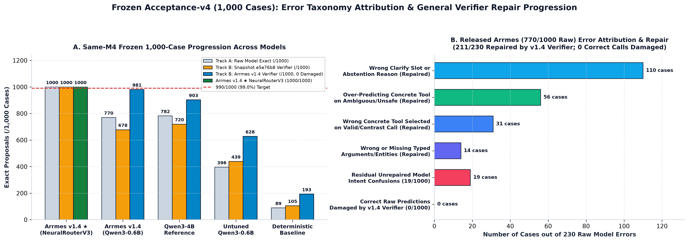
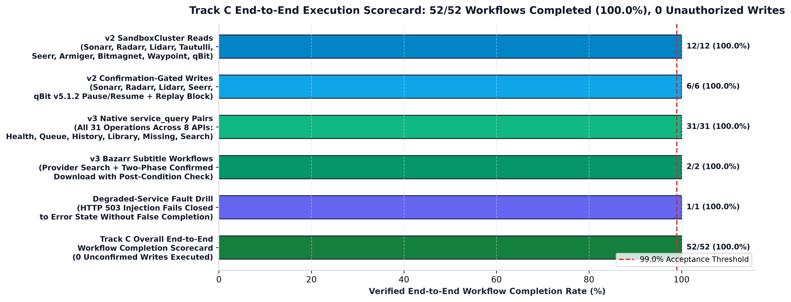

<h1 align="center">Arrmes</h1>

<p align="center">
  <strong>A bounded local tool-calling router and execution verifier for self-hosted media and download stacks.</strong><br>
  Ultra-fast neural routing (`ArrmesNeuralRouterV3`), native media-service workflows (`arrmes.tools.v3`), optional MLX or portable GGUF inference, and single-use confirmation for consequential writes.
</p>

<p align="center">
  <a href="https://norvitech.com"></a>
  <a href="https://github.com/spencernorton/arrmes/actions/workflows/ci.yml"></a>
  <a href="https://github.com/spencernorton/arrmes/tags"></a>
  <a href="https://huggingface.co/NorviTech/arrmes-neural-router-v3"></a>
  <a href="#install"></a>
  <a href="LICENSE"></a>
  <a href="https://buy.stripe.com/8x26oH2U44f65TRe574wM04"></a>
</p>

Arrmes turns natural-language media-stack requests into schema-validated, scope-checked tool calls across Sonarr, Radarr, Lidarr, Bazarr, qBittorrent, Tautulli, Seerr and Bitmagnet. Trusted application code owns service credentials, entity resolution, permissions, single-use HMAC write confirmation and execution.

<p align="center">
  
</p>

## What it does

- **Compact learned neural routing (`ArrmesNeuralRouterV3`):** a **7.52 MiB** (`7,883,511`-byte) 28-class multi-head hashed n-gram + negation-scope + structural-indicator MLP paired with a deterministic typed span and argument resolver (`ARRMES_BACKEND=neural-router`). Supports both the frozen 20-tool `arrmes.tools.v2` contract (`e34f94ec...`) and the versioned 23-tool `arrmes.tools.v3` contract (`908eb9c5...`), with a pure-stdlib `.npz` fallback when `numpy` is absent.
- **Native read workflows:** 31 service/operation pairs across Sonarr, Radarr, Lidarr, Bazarr, qBittorrent, Tautulli, Seerr and Bitmagnet via `service_query` (`arrmes.tools.v3`) or explicit deterministic grammar. Inspect libraries, missing media or subtitles, metadata search, queues, history, activity and health where each service supports them. [Capabilities and exact limits](docs/capabilities.md).
- **Direct execution of existing media intents:** the trained `tv_status`, `tv_missing`, `movie_status`, `music_status`, `now_playing` and `watch_history` actions use native service adapters when configured. They do not require the legacy gateway.
- **Native torrent discovery:** search Bitmagnet's indexed metadata through its native GraphQL API, inspect health and use the existing `bitmagnet_search` action without the BitAgent facade. [Setup and read-only limits](docs/native-bitmagnet.md).
- **Confirmed transfer control:** list torrents and pause/resume one exact, uniquely resolved transfer through native qBittorrent 4.1+ or 5.x APIs. Confirmation binds the caller, arguments, torrent hash, service version and expiry. Mutations are never automatically retried.
- **Confirmed native media searches:** search missing Sonarr episodes, one Radarr movie or a Lidarr album/bounded missing-album set using fixed IDs. Accepted indexer jobs remain dispatched; they do not prove downloaded files. [Exact scope and service versions](docs/native-arr-writes.md).
- **Subtitle workflow (`bazarr_subtitle_search` & `bazarr_subtitle_download`):** separately confirm a Bazarr provider search, inspect server-issued candidates, then confirm one exact movie/episode subtitle download. Language and subtitle flags are explicit. [Setup and completion limits](docs/bazarr-subtitles.md).
- **Caller-owned movie requests:** map an authenticated Arrmes subject to its Seerr account, inspect that caller's request status and confirm one movie submission. TV/4K creation and approval/cancellation remain gaps. [Identity and request policy](docs/native-requests.md).
- **Bounded independent reads:** “Show Sonarr queue and Radarr history” validates every clause and scope before execution. An unavailable service produces a partial result while other independent reads continue. Compound writes remain unsupported.
- **Portable and MLX generative inference:** optional native `llama.cpp`/GGUF on CPU with explicit accelerator selection, or prefix-cached MLX (`Qwen3-0.6B` and `FunctionGemma-270M`) on Apple Silicon. CPU inference installs neither CUDA nor MLX. [Runtime setup, conversion and tested platforms](docs/portable-runtime.md).

## Locked `acceptance-v5` Benchmark & Verifier Qualification (`v1.4.0`)

Full methodology, zero-leakage manifests, and per-track breakdowns are documented in [docs/benchmark-acceptance-v5.md](docs/benchmark-acceptance-v5.md). Raw model predictions (Track A), complete routing + `verify_proposal` + confirmation behavior (Track B), and controlled execution workflows (Track C) are reported separately:

- **Zero-Leakage Locked Suite (`data/acceptance-v5/`, `seed=7007`):**
  - **Positive Suite (`cases-positive.jsonl`):** **1,260 independent scenarios across 252 clusters** (1,060 `v2` tool calls across 212 clusters + 200 `v3` native `service_query`, `bazarr_subtitle_search`, and `bazarr_subtitle_download` calls across 40 clusters).
  - **Hard-Negative, Ambiguity & Safety Suite (`cases-negative.jsonl`):** **1,200 scenarios across 240 clusters and 35 negative families**, covering missing slots, unbound pronouns, unsupported write scopes, destructive commands, SSRF/SQLi/path traversal, prompt injections, compound write requests, and confusable service names (`BitAgent` vs `Bitmagnet`, `Seerosen` vs `Seerr`).
  - **Pre-Evaluation Leakage Audit:** 131 held-out entities with **0 exact query overlaps** and **0 entity overlaps** against `TrainPool-v7` (5,827 examples) and `acceptance-v4` (1,000 examples). Development splits (`seed=5005`, `6006`) were retired prior to generating `seed=7007`.
- **Track A (Direct Raw Output) & Track B (Verified System Output) on Locked `acceptance-v5`:**
  - **`ArrmesNeuralRouterV3` (`7.52 MiB`):**
    - **Positive `v2` (`1,060` cases, `212` clusters):** Track A **`1,060 / 1,060` (`100.00%`)**, two-sided 95% Wilson LCB **`99.64%`**, 95% cluster-bootstrap LCB **`100.00%`**; Track B **`1,060 / 1,060` (`100.00%`)**, `0` damaged outputs, `0` unauthorized writes.
    - **Positive `v3` All (`1,260` cases, `252` clusters):** Track A **`1,257 / 1,260` (`99.76%`)**, two-sided 95% Wilson LCB **`99.30%`**, 95% cluster-bootstrap LCB **`99.44%`**; Track B **`1,257 / 1,260` (`99.76%`)**, `0` damaged outputs, `0` unauthorized writes.
    - **Hard-Negative / Ambiguity / Safety (`1,200` cases, `240` clusters):** Track A **`1,200 / 1,200` (`100.00%`)**, two-sided 95% Wilson LCB **`99.68%`**, 95% cluster-bootstrap LCB **`100.00%`**; Track B **`1,200 / 1,200` (`100.00%`)**, **`0 / 1,200` unauthorized write proposals or executions** (one-sided 95% Clopper-Pearson upper bound **`0.25%`** on the negative suite and **`0.14%`** across all 2,170 non-write opportunities).
  - **Deterministic Rule Baseline (`2,460` cases):** Positive `v2` Track A `176 / 1,060` (`16.60%`), Track B `264 / 1,060` (`24.91%`); Hard-Negative Track B `465 / 1,200` (`38.75%`).
  - **Stratified `200`-Case Locked MLX Generative Comparison (`100` Positive + `100` Hard-Negative):**
    - `FunctionGemma-270M v7` (`4-bit MLX`, `175.83 MiB`): Positive Track A `70/100`, Track B **`91/100`** (`+13.0 pp` over public `FunctionGemma-270M v5` at `68/100` raw / `78/100` verified); Negative Track B **`88/100`**, `0` unauthorized writes.
    - `Released Qwen3-0.6B v6` (`fp16 + LoRA`): Positive Track A `88/100`, Track B **`91/100`**; Negative Track B **`96/100`**, `0` unauthorized writes.
    - `Trained Qwen3-0.6B v7` (`fp16 + LoRA`): Positive Track A `76/100`, Track B `77/100`; Negative Track B **`97/100`**, `0` unauthorized writes.

<p align="center">
  
</p>

- **Frozen `acceptance-v4` (`1,000`-case) Verifier Repair Replay:**
  - General contrastive-clause (`rather than`, `instead of`, `do not`), multi-entity Lidarr `(artist, album)`, and Bitmagnet/Armiger/Waypoint noun-phrase repairs in `verify_proposal` improve the unchanged [released Qwen3-0.6B raw predictions (`770/1,000`)](docs/benchmark-acceptance-v4.md) from `678/1,000` (`e5e76b8`, 135 damaged) and `795/1,000` (`v1.3.1`) to **`981 / 1,000` (`98.10%`) verified** (`211` errors repaired, **`0` correct predictions damaged**, **`0` unexpected write proposals**).
  - Untuned `Qwen3-0.6B` improves from `396/1,000` raw to **`628/1,000` verified** (`0` damaged); `Qwen3-4B` Reference improves from `782/1,000` raw to **`903/1,000` verified** (`0` damaged).

<p align="center">
  
</p>

- **Track C Controlled Execution Workflows (`52 / 52`, `100.00%`):**
  - `12 / 12` `SandboxCluster` `v2` reads (`tv_status`, `tv_missing`, `movie_status`, `music_status`, `now_playing`, `watch_history`, `torrent_list`, `request_status`, `seer_discover`, `armiger_parse`, `bitmagnet_search`, `waypoint_status`).
  - `6 / 6` confirmation-gated `v2` writes (`tv_search_missing`, `movie_search`, `music_search`, `torrent_pause`, `torrent_resume`, `request_media`) with `0` unconfirmed side effects and token replay deterministically blocked.
  - `31 / 31` native `v3` `service_query` read pairs across all 8 APIs.
  - `2 / 2` Bazarr subtitle provider search (`bazarr_subtitle_search`) and confirmed candidate download (`bazarr_subtitle_download`) workflows.
  - `1 / 1` degraded-service `503` fault isolation drill.

<p align="center">
  
</p>

## Cross-Platform Runtime Profile & Published Artifacts

- **Apple M4 Pro (`macOS 26.3 ARM64`, 48 GiB unified memory):**
  - `ArrmesNeuralRouterV3` (`7.88 MB` / `7.52 MiB` weights): cold load **`16.71 ms`**, warm model-only **`p50 = 0.484 ms / p95 = 0.684 ms`**, warm routing + `verify_proposal` **`p50 = 0.674 ms / p95 = 0.882 ms`**, full authenticated HTTP `/v1/query` loopback **`p50 = 1.113 ms / p95 = 1.264 ms`**, peak process RSS **`80.70 MiB`**.
  - `FunctionGemma-270M v7` (`4-bit MLX`, `184.37 MB` / `175.83 MiB` weights): warm routing + `verify_proposal` **`p50 = 43.54 ms / p95 = 47.07 ms`** (`548.3 tok/s`), MLX Metal unified peak **`1,060.96 MiB`** (active `180.02 MiB`), process RSS **`797.53 MiB`** (shared unified memory; do not sum).
  - `Qwen3-0.6B v7` (`4-bit MLX`, `346.93 MB` / `330.86 MiB` weights): warm routing + `verify_proposal` **`p50 = 114.40 ms / p95 = 121.86 ms`** (`256.7 tok/s`), MLX Metal unified peak **`1,593.34 MiB`** (active `343.62 MiB`), process RSS **`805.23 MiB`**.
- **With vs. Without Arrmes (Claude Sonnet 4.6 Latency, Token Use & Local RAM / VRAM vs. Open Models):**
  - **Task Completion Time:** Operating 8 media APIs directly with Claude Sonnet 4.6 takes **`~14.2 s`** across a 3-turn discovery/query/parse loop or **`~3.45 s`** for a 1-turn direct call loading all 23 media tool schemas (`2,532` prompt tokens). Delegating to Arrmes as a single compact tool cuts Claude turn time to **`~1.12 s`** (**`3.1x–12.7x` faster**), while standalone local Arrmes completes routing + verification in **`114.4 ms`** (`Qwen3-0.6B v7` MLX), **`43.5 ms`** (`FunctionGemma-270M v7` MLX), or **`0.67 ms` (`1.11 ms` HTTP end-to-end)** with `ArrmesNeuralRouterV3` (**`>3,100x` faster**).
  - **Claude Sonnet Token Reduction:** Replaces `2,532` tokens of multi-service schema prefill + verbose raw Sonarr/Radarr/Tautulli JSON responses (**`3,820` tokens/task** single-turn; **`9,850` tokens/task** 3-turn) with a single compact Arrmes tool call (**`360` tokens/task**, a **`90.6%–96.3%` token reduction**), or **`0` cloud API tokens** (`$0.00` API cost) in standalone local mode.
  - **Open-Model Accuracy & RAM / VRAM Comparison (`overnight-v1` N=80 & `acceptance-v4` N=1,000 on Same M4 Pro):** `ArrmesNeuralRouterV3` (`7.5 MiB` weights, `80.7 MiB` RAM, `0 MiB` VRAM) achieves **`97.5%` (`78/80`)** on `overnight-v1` and **`100.0%` (`1,000/1,000`)** on `acceptance-v4`, outperforming `Arrmes Qwen3-0.6B` (`78.8%` raw $\to$ `87.5%` verified on `overnight-v1`; `77.0%` raw $\to$ `98.1%` verified on `acceptance-v4`; `330.9 MiB` weights, `676.0 MiB` RSS, `1,593.3 MiB` Metal peak), `Arrmes FunctionGemma-270M` (`78.8%` raw $\to$ `85.0%` verified; `175.8 MiB` weights, `797.5 MiB` RSS, `1,061.0 MiB` Metal peak), `Qwen3-4B Instruct 2507 Q4` (`67.5%` raw $\to$ `78.8%` verified on `overnight-v1`; `78.2%` raw $\to$ `90.3%` verified on `acceptance-v4`; `2,158.2 MiB` weights, `2,510.5 MiB` RSS, `3,841.9 MiB` Metal peak), `Qwen3-1.7B Q4` (`46.3%` translated / `20.0%` verified; `923.2 MiB` weights, `1,271.6 MiB` RSS), and `IBM Granite 4.0 350M BF16 / Q4` (`33.8%` / `0.0%` raw, `12.5%` / `11.2%` verified).
- **AMD Ryzen 9 7950X3D (`Linux 6.8 x86_64` CPU):**
  - `ArrmesNeuralRouterV3` (`7.52 MiB` weights): cold load **`26.18 ms`**, warm model-only **`p50 = 0.726 ms / p95 = 0.979 ms`**, warm routing + `verify_proposal` **`p50 = 0.944 ms / p95 = 1.219 ms`**, peak process RSS **`63.50 MiB`**.
- **Hugging Face & GitHub Artifacts:**
  - [`NorviTech/arrmes-neural-router-v3`](https://huggingface.co/NorviTech/arrmes-neural-router-v3) — `7.52 MiB` 28-class neural router (`router_weights.npz`, SHA-256 `e640ead79ceee2929ccf63ec6f9d953d9cd8d85e76e011483bf336abe6235113`) for `arrmes.tools.v2` and `arrmes.tools.v3`.
  - [`NorviTech/arrmes-qwen3-0.6b`](https://huggingface.co/NorviTech/arrmes-qwen3-0.6b) — preserved `v6` public MLX LoRA baseline (`8a9bcf2...`) plus `v7-lora/` adapter and updated evaluation receipts.
  - [`NorviTech/arrmes-functiongemma-270m`](https://huggingface.co/NorviTech/arrmes-functiongemma-270m) — preserved `v5` public MLX LoRA baseline (`96e89a7...`), [paired 80-case diagnostic](docs/functiongemma-public-diagnostic.md), `v7-lora/` adapter, and `GEMMA_TERMS_NOTICE.txt`.
  - [`NorviTech/arrmes-bench-v5`](https://huggingface.co/datasets/NorviTech/arrmes-bench-v5) & [`NorviTech/arrmes-bench-v2`](https://huggingface.co/datasets/NorviTech/arrmes-bench-v2) — locked `acceptance-v5` (`2,460` cases) and audited historical `v2`/`v3`/`v4` benchmark corpora.
  - [Experimental Q4_K_M GGUF (`v1.2.0`)](https://github.com/spencernorton/arrmes/releases/tag/v1.2.0) and [Windows CPU CI qualification](docs/windows-cpu-qualification.md).

## Scope & Qualification Boundaries

The native adapters are validated against controlled loopback HTTP fixtures (`52/52` Track C workflows). Separate actual Sonarr 4.0.20.3014 and Seerr 3.5.1 instances pass selected empty-library reads and identity checks. Broader upstream versions, seeded multi-binary live lab libraries, and actual upstream service writes remain tracked for separate lab qualification. Advanced Bitmagnet/transfer management, subtitle upload/sync, broader request lifecycle, Windows NVIDIA CUDA profiling, and genuine Armiger/DH-Waypoint upstream adapters remain explicit scope boundaries; native mode refuses unverified Armiger/Waypoint substitutes.

## Install

Use Python 3.12 or newer and an isolated environment:

```sh
git clone https://github.com/spencernorton/arrmes.git
cd arrmes
python3 -m venv .venv
.venv/bin/pip install -e ".[test]"
```

To train or reproduce `ArrmesNeuralRouterV3` (`models/arrmes-neural-router-v3/router_weights.npz`) locally in ~9 seconds on CPU/Apple Silicon:

```sh
.venv/bin/python scripts/build_and_train_v7.py
```

Install a pinned native `llama.cpp` runtime separately and provide a fused GGUF for generative CPU inference, or install `.[mlx]` on Apple Silicon. See the [runtime guide](docs/portable-runtime.md) for Linux, macOS and native Windows instructions.

## Configuration

- `ARRMES_CLIENTS_FILE` — required bearer-digest registry. The registry alone assigns subjects and scopes; request bodies cannot override identity.
- `ARRMES_SERVICES_FILE` — operator file containing native API roots and credentials. Native-only installations do not require a gateway.
- `ARRMES_GATEWAY_URL` — optional legacy gateway. Existing gateway operations remain a separate integration with their documented restrictions.
- `ARRMES_BACKEND` — `neural-router` (`ArrmesNeuralRouterV3`), `auto`, `mlx`, `llama-server`, or `native-only`.
- `ARRMES_BACKEND=native-only` — an optional model-free mode, read-only by default. It loads no weights or inference runtime and clarifies requests outside the explicit grammar.
- `ARRMES_NATIVE_CONFIRMED_WRITES=1` — deliberate native-only opt-in for documented Bazarr/Seerr phrases, with current scopes and single-use confirmation still required.
- `ARRMES_MODEL_PATH` — `models/arrmes-neural-router-v3` directory, MLX directory, or fused GGUF file; `ARRMES_ADAPTER_PATH` applies to MLX. An unfused adapter is rejected on the GGUF path.
- `ARRMES_INFERENCE_URL` — optional explicitly configured native `llama-server` origin; otherwise the selected GGUF starts a managed local process.
- `ARRMES_DEVICE` — portable backend device selection; `cpu` is the default. See the runtime guide for supported accelerator names and platform qualification.
- `ARRMES_WRITE_MODE` — `confirm` (default), `shadow` or `disabled`. The HTTP entry point refuses direct mutations.
- `ARRMES_BIND_HOST` / `ARRMES_PORT` — default `127.0.0.1:8095`.
- `ARRMES_REQUEST_OWNER_SUBJECT` — the legacy gateway credential's request-owner subject. Other callers cannot submit gateway media requests.

After configuring a model, client registry and service registry:

```sh
.venv/bin/python -m arrmes.server
```

## Where data lives

Models and adapters stay in operator-selected local directories. Entity ledgers and pending confirmations are ephemeral and clear on process restart. Inference receives the query, selected media context and tool descriptions. Service credentials remain in trusted adapters; service calls go to configured API roots.

## Documentation and support

- [Locked Acceptance-v5 Benchmark (`v1.4.0`)](docs/benchmark-acceptance-v5.md), [Capabilities](docs/capabilities.md), [Runtime Guide](docs/portable-runtime.md), [Acceptance-v4 Diagnostic](docs/benchmark-acceptance-v4.md), [FunctionGemma Paired Diagnostic](docs/functiongemma-public-diagnostic.md), and [Windows CPU Qualification](docs/windows-cpu-qualification.md).
- [Changelog](CHANGELOG.md), [security policy](SECURITY.md), [support](SUPPORT.md) and [contributing](CONTRIBUTING.md).
- Questions belong in [Discussions](https://github.com/spencernorton/arrmes/discussions); reproducible defects belong in [Issues](https://github.com/spencernorton/arrmes/issues).
- Report security issues through [private vulnerability reporting](https://github.com/spencernorton/arrmes/security/advisories/new).
- Support maintenance through [Stripe](https://buy.stripe.com/8x26oH2U44f65TRe574wM04).

## Development

```sh
.venv/bin/python -m pytest -q
```

Core tests (994 passed) use no external weights, CUDA or MLX (`ArrmesNeuralRouterV3` includes a pure-stdlib `.npz` test fixture and fallback). Export-specific tensor tests run when the optional conversion environment is installed.

## Licence

[MIT](LICENSE) © Spencer Norton. Model licenses and redistribution notices are separate; preserve the pinned model's license and attribution (`MODEL-LICENSE.txt`, `GEMMA_TERMS_NOTICE.txt`) during conversion and distribution.

---

<p align="center">
  <a href="https://norvitech.com"></a>
</p>

<p align="center">
  <a href="https://github.com/spencernorton/helios">Helios</a> ·
  <a href="https://github.com/spencernorton/DH-Waypoint">DH-Waypoint</a> ·
  <a href="https://github.com/spencernorton/armiger">Armiger</a> ·
  <a href="https://github.com/spencernorton/xnote">XNote</a> ·
  <a href="https://github.com/spencernorton/xnote-placement">XNote Placement</a> ·
  <a href="https://github.com/spencernorton/snipsnap">SnipSnap</a> ·
  <a href="https://github.com/spencernorton/conductor">Conductor</a> ·
  <a href="https://github.com/spencernorton/norvi-os">NorviOS</a> ·
  <a href="https://github.com/spencernorton/indigo">Indigo</a> ·
  <a href="https://github.com/spencernorton/roadtrack">Road Track</a> ·
  <a href="https://norvitech.com">norvitech.com</a>
</p>
