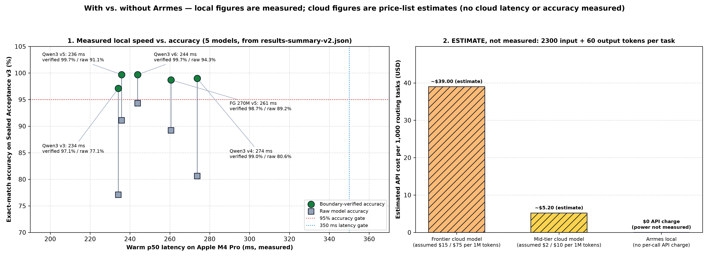
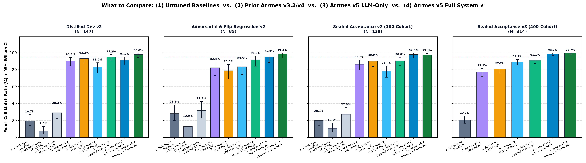

<h1 align="center">Arrmes</h1>

<p align="center">
  <strong>A bounded local tool-calling router and execution verifier for self-hosted media and download stacks.</strong><br>
  Routes natural-language requests across nine self-hosted services in about a quarter of a second on local hardware, with no cloud calls and single-use confirmation for write operations.
</p>

<p align="center">
  <a href="https://norvitech.com"></a>
  <a href="https://github.com/spencernorton/arrmes/actions/workflows/ci.yml"></a>
  <a href="https://github.com/spencernorton/arrmes/tags"></a>
  <a href="#install"></a>
  <a href="LICENSE"></a>
  <a href="https://buy.stripe.com/8x26oH2U44f65TRe574wM04"></a>
</p>

<p align="center">
  
  <br>
  <em>Local latency and accuracy are measured on the sealed qualification suite; cloud costs are list-price estimates.</em>
</p>

Arrmes is a compact local function-calling router and deterministic policy guardrail for operators running Sonarr, Radarr, Lidarr, Tautulli, qBittorrent, Seer, media request portals, Bitmagnet, and release parsers. It pairs a 4-bit Qwen3 0.6B base with a fine-tuned LoRA adapter (about 344 MB together) and an entity-agnostic pre-dispatch verification boundary, so read queries route in roughly a quarter of a second and write operations require explicit confirmation.

## What it does

**Deterministic twenty-action tool contract.** Arrmes maps natural-language utterances into twenty strictly typed operations (`arrmes.tools.v2`) spanning library status lookups, missing-episode audits, indexer searches, media requests, stream activity, watch history, torrent queue inspection, and single-item transfer control. Every proposed call is validated against strict JSON schema, argument bounds, and caller permission scopes before reaching any adapter.

**Entity-agnostic pre-dispatch verification.** Before any tool call leaves the router, `verify_proposal` confirms that extracted titles, artists, albums, and release strings are grounded either in the user utterance or in the caller's verified `SessionEntityLedger`. Unbound pronouns, missing titles, compound multi-action prompts, and destructive requests (`delete`, `wipe`, `pause all`, credential probes) are deterministically routed to structured `clarify` or `unsupported` responses with zero unsafe write executions.

**Propose-and-confirm write gating.** Read-only actions enforce an HTTP `GET` transport invariant and redact upstream API tokens from audit trails. Write-effect actions first resolve the target entity via read-only lookup, then mint an HMAC-SHA256 confirmation token (`confirm_id`, default TTL 300 seconds) bound to the authenticated principal and canonical arguments; no upstream state changes until the caller redeems that token.

**Fast local inference with no API charges.** A 4-bit base model with an fp16 rank-8 LoRA adapter and dual system/tool KV prefix caching completes warm tool-call routing in roughly 230–245 ms (measured p50 on an Apple M4 Pro) with a ~344 MB disk footprint.

<p align="center">
  
</p>

## Install

### Apple Silicon — from source

Inference uses MLX on Apple Silicon. Install the package and the MLX extra in an isolated virtual environment, then provide the base model, adapter, client registry and gateway URL (see Configuration):

```sh
git clone https://github.com/spencernorton/arrmes.git
cd arrmes
python3 -m venv .venv
.venv/bin/pip install -e ".[mlx,test]"
.venv/bin/python -m arrmes.server
```

A Linux inference runtime and container image are not provided yet.

## Documentation

- [CHANGELOG.md](CHANGELOG.md) — release history and contract changes.
- [SECURITY.md](SECURITY.md) — trust boundary, write-confirmation invariants, and vulnerability reporting.
- [SUPPORT.md](SUPPORT.md) — usage questions and issue routing.
- [CONTRIBUTING.md](CONTRIBUTING.md) — development workflow, testing requirements, and scope rules.

## Configuration

Configure the HTTP server (`arrmes.server`) through environment variables:

- `ARRMES_CLIENTS_FILE` — required. JSON client registry, `{"clients": [{"subject": "user:alice", "token_sha256": "<sha256 of the bearer token>", "scopes": ["media:read", ...]}]}`. Caller identity and scopes come only from this registry; request bodies may not carry them. The service refuses to start without it.
- `ARRMES_GATEWAY_URL` — required. Base URL of the self-hosted API gateway.
- `ARRMES_WRITE_MODE` — `confirm` (default; single-use confirmation tokens), `shadow` (log proposed writes without executing them), `disabled`, or `direct`.
- `ARRMES_MODEL_PATH` / `ARRMES_ADAPTER_PATH` — the 4-bit base model directory and LoRA adapter directory.
- `ARRMES_BIND_HOST` / `ARRMES_PORT` — listen address and port (default `127.0.0.1:8095`).
- `ARRMES_REQUEST_OWNER_SUBJECT` — the one client subject allowed to submit live media requests; the request service attributes gateway submissions to the gateway credential's owner, so other callers are refused.

## Where your data lives

- `./models/` — pinned local model weights and tokenizer files (read-only at runtime).
- `./adapters/` — fine-tuned LoRA adapter checkpoints (read-only at runtime).
- In-memory `SessionEntityLedger` and `WriteConfirmationStore` — ephemeral per-principal entity context (3-turn TTL) and pending confirmation tokens (300-second TTL), cleared on process restart.

Nothing leaves the machine: inference runs locally and service calls go only to the configured self-hosted gateway.

## Contributing and support

- Questions, setup help, and general discussion belong in [GitHub Discussions](https://github.com/spencernorton/arrmes/discussions), and reproducible defects belong in [GitHub Issues](https://github.com/spencernorton/arrmes/issues).
- Report security issues through [GitHub private vulnerability reporting](https://github.com/spencernorton/arrmes/security/advisories/new) as described in [SECURITY.md](SECURITY.md). There is no e-mail address; that is deliberate.
- Read [CONTRIBUTING.md](CONTRIBUTING.md) before opening a pull request; pull requests are reviewed and squash-merged here.
- If Arrmes is useful in your stack, you can support ongoing maintenance via [Stripe](https://buy.stripe.com/8x26oH2U44f65TRe574wM04).

## Development

Run the full sandbox verification and unit test suite:

```sh
.venv/bin/pytest -q
```

## Licence

[MIT](LICENSE) © Spencer Norton

---

<p align="center">
  <a href="https://norvitech.com"></a>
</p>

<p align="center">
  <a href="https://github.com/spencernorton/helios">Helios</a> ·
  <a href="https://github.com/spencernorton/DH-Waypoint">DH-Waypoint</a> ·
  <a href="https://github.com/spencernorton/armiger">Armiger</a> ·
  <a href="https://github.com/spencernorton/xnote">XNote</a> ·
  <a href="https://github.com/spencernorton/xnote-placement">XNote Placement</a> ·
  <a href="https://github.com/spencernorton/snipsnap">SnipSnap</a> ·
  <a href="https://github.com/spencernorton/conductor">Conductor</a> ·
  <a href="https://github.com/spencernorton/norvi-os">NorviOS</a> ·
  <a href="https://github.com/spencernorton/indigo">Indigo</a> ·
  <a href="https://github.com/spencernorton/roadtrack">Road Track</a> ·
  <a href="https://norvitech.com">norvitech.com</a>
</p>
