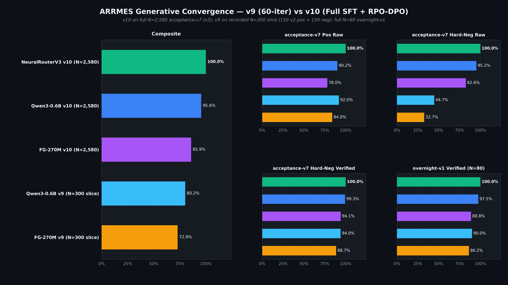

# Arrmes

Local control for your self-hosted media stack.

[](https://github.com/spencernorton/arrmes/actions/workflows/ci.yml)
[](https://github.com/spencernorton/arrmes/releases)
[](LICENSE)
[](https://norvitech.com/arrmes/)
[](https://huggingface.co/NorviTech/arrmes-qwen3-0.6b)

Arrmes turns plain-language requests into validated API calls across Sonarr, Radarr,
Lidarr, Prowlarr, Readarr/Chaptarr, Whisparr, Bazarr, qBittorrent, Tautulli, Seerr,
and Bitmagnet. Routing runs locally; service credentials stay in the application.

## What it does

- Check libraries, missing or cutoff-unmet media, quality profiles, indexers, upcoming calendar airings, queues, watch history, and current activity.
- Search Prowlarr indexers and Bitmagnet's torrent index (with optional content-type filtering).
- Pause or resume a specific qBittorrent transfer.
- Search for missing episodes, movies, albums, books, or subtitles, including bounded read-to-confirm workflows.
- Submit movie or TV series/season requests through Seerr, check caller-isolated request status, and cancel pending requests.

For example:

```text
Show Sonarr queue
Show Radarr history
What episodes of Severance are missing in Sonarr?
Search Prowlarr for Ubuntu
Check Readarr missing books
```

Writes require explicit, single-use HMAC confirmation. Ambiguous targets prompt for
clarification. Supported operations vary by service; see the
[capability guide](docs/capabilities.md) for versions and limits.

## Install

Requires Python 3.12+. On macOS or Linux:

```sh
git clone https://github.com/spencernorton/arrmes.git
cd arrmes
python3 -m venv .venv
.venv/bin/python -m pip install -e .
```

Follow the [HTTP setup](docs/portable-runtime.md#authenticated-http-service) to
create private client and service registries, start the server, and make a first
request. It starts in model-free mode with read-only permissions.

For learned routing, use the [7.48 MiB neural router](docs/portable-runtime.md#neural-router).
Optional [GGUF](docs/portable-runtime.md#cpu-installation) and
[MLX](docs/portable-runtime.md#routing-backends) backends are also available.
See the runtime guide for [Windows](docs/portable-runtime.md#native-windows)
and [Docker](docs/portable-runtime.md#linux-containers) setup.

## Benchmarks

Recorded neural-router, hybrid, and unassisted `v10` generative results on the sealed template-skeleton-disjoint `acceptance-v8` (`N=3,135`), full `acceptance-v7` (`N=2,580`), and open-phrasing `overnight-v1` (`N=80`) suites:

- **Sealed `acceptance-v8` (`N=3,135`: `1,685` positives across all `11` services and `68` `service_query` pairs + `1,450` hard negatives, zero skeleton overlap):** `ArrmesNeuralRouterV3 v10` reaches `1,644 / 1,685` (`97.57%` Track A raw) and `1,649 / 1,685` (`97.86%` Track B verified; `97.57%` pre-audit frozen baseline) on positives, and `1,379 / 1,450` (`95.10%` raw) and `1,394 / 1,450` (`96.14%` verified) on hard negatives; `HybridRouterMLXModel v10` reaches `94.96%` verified positives and `96.21%` verified hard negatives.
- **Unassisted `Qwen3-0.6B v10` (28-class SFT + NLL-anchored RPO-DPO):** `1,374 / 1,685` (`81.54%` raw) and `1,419 / 1,685` (`84.21%` verified) on `acceptance-v8` positives, and `1,249 / 1,450` (`86.14%` raw) and `1,381 / 1,450` (`95.24%` verified, `0` unauthorized verified writes) on `acceptance-v8` hard negatives; on full `acceptance-v7` (`N=2,580`), hard-negative accuracy climbs from `v9`'s `44.67%` raw to `95.17%` raw (`1,142 / 1,200`) and `99.33%` verified (`1,192 / 1,200`, `0` unauthorized writes), and `overnight-v1` (`N=80`) climbs from `80.0%` raw / `90.0%` verified to `97.50%` raw and `97.50%` verified (`78 / 80`).
- **Unassisted `FunctionGemma-270M v10` (28-class SFT + positive-anchored RPO-DPO):** hard-negative accuracy on full `acceptance-v7` (`N=1,200`) rises from `v9`'s `32.67%` raw to `82.58%` raw (`991 / 1,200`) and `94.08%` verified (`1,129 / 1,200`, `0` unauthorized writes), `overnight-v1` (`N=80`) reaches `82.50%` raw / `88.75%` verified on merged BF16 (`70.00%` raw / `82.50%` verified on 4-bit MLX, `82.50%` raw / `90.00%` verified on 8-bit MLX, `88.75%`–`90.00%` verified on `Q4_K_M` GGUF across CPU/Metal/CUDA, and `87.50%` Linux CPU / `88.75%` CUDA verified on `Q8_0` GGUF), and sealed `acceptance-v8` reaches `65.34%` verified positives (`1,101 / 1,685`) and `91.59%` verified hard negatives (`1,328 / 1,450`, with `26 / 3,135` unauthorized verified write proposals gated behind explicit confirmation).
- **Locked `acceptance-v7` (`N=2,580`) and `overnight-v1` (`N=80`) neural router regression:** `ArrmesNeuralRouterV3 v10` retains `1,380 / 1,380` (`100.00%`) positive calls, `1,200 / 1,200` (`100.00%` under `v3` contract; `1,195 / 1,200` or `99.58%` under strict `v2`-only contract) hard negatives, `80 / 80` (`100.00%`) `overnight-v1` exact calls, and bitwise-identical outputs across macOS ARM64 and Linux x86_64.
- **11-service live upstream Docker container binary qualification (`experiments/upstream-lab-v1/summary.json`):** `73 / 73` (`100.00%` live checks across official Sonarr v4, Radarr v5/v6 with 320 seeded movies + confirmed `MoviesSearch`, Lidarr v2, Readarr 0.4.19 with seeded author/book + confirmed `BookSearch`, Whisparr 3.6.5 v3 `eros`, Prowlarr v1, Bazarr 1.6+, Tautulli v2, qBittorrent v5, Bitmagnet v0.10.1 + PostgreSQL 16 GraphQL search, and Seerr 3.5.1 with caller-owned status and confirmed request cancellation).


[Recorded `acceptance-v8` scores](experiments/acceptance-v8/summary.json), [recorded `acceptance-v7` scores](experiments/acceptance-v7/summary.json), and [`v10` training provenance](experiments/mlx-lora-v10-provenance.json) report Track A unmodified model output separately from Track B verified system proposals.




[Recorded `v10` runtime profiles](experiments/runtime-profile-v10.json): `0.416 ms` warm p50 on Apple M4 Pro CPU and `0.714 ms` warm p50 on AMD Ryzen 9 7950X3D CPU for `ArrmesNeuralRouterV3 v10` (`7.48 MiB`); `39.81 ms` (`FunctionGemma-270M v10` 4-bit MLX, `184.37 MB`) and `111.32 ms` (`Qwen3-0.6B v10` 4-bit MLX, `346.93 MB`) on Apple M4 Pro Metal; `131.32 ms` Linux Ryzen 9 7950X3D 8-thread CPU p50 and `40.73 ms` RTX 4070 Ti SUPER CUDA p50 for portable `FunctionGemma-270M v10 Q4_K_M` GGUF (`261.33 MB`), plus `53.01 ms` CUDA p50 for `Qwen3-0.6B v10 Q4_K_M` GGUF (`396.70 MB`); and `1.33 us` p50 exact title lookup (`21,272.9x` faster than `28.38 ms` linear scan) plus `0.96 us` p50 diacritic/alternate-title lookup across a 5,000-movie library via `CatalogInvertedIndex`.

## Documentation

- [Supported services and configuration](docs/capabilities.md)
- [Runtime setup and measured performance](docs/portable-runtime.md)
- [Subtitle operations](docs/bazarr-subtitles.md), [movie & TV requests](docs/native-requests.md), [media searches](docs/native-arr-writes.md), and [Bitmagnet](docs/native-bitmagnet.md)
- [Contributing](CONTRIBUTING.md), [changelog](CHANGELOG.md), and [security](SECURITY.md)

Questions: [Discussions](https://github.com/spencernorton/arrmes/discussions).
Bugs: [Issues](https://github.com/spencernorton/arrmes/issues).
Security issues: [private reporting](https://github.com/spencernorton/arrmes/security/advisories/new).

## Licence

[MIT](LICENSE) © Spencer Norton. Model weights have separate licences and notices.

[Support development](https://buy.stripe.com/8x26oH2U44f65TRe574wM04)

---

<p align="center">
  <a href="https://norvitech.com"></a>
</p>

<p align="center">
  <a href="https://github.com/spencernorton/helios">Helios</a> ·
  <a href="https://github.com/spencernorton/DH-Waypoint">DH-Waypoint</a> ·
  <a href="https://github.com/spencernorton/armiger">Armiger</a> ·
  <a href="https://github.com/spencernorton/arrmes">Arrmes</a> ·
  <a href="https://github.com/spencernorton/endexis">Endexis</a> ·
  <a href="https://github.com/spencernorton/xnote">XNote</a> ·
  <a href="https://github.com/spencernorton/xnote-placement">XNote Placement</a> ·
  <a href="https://github.com/spencernorton/snipsnap">SnipSnap</a> ·
  <a href="https://github.com/spencernorton/conductor">Conductor</a> ·
  <a href="https://github.com/spencernorton/norvi-os">NorviOS</a> ·
  <a href="https://github.com/spencernorton/indigo">Indigo</a> ·
  <a href="https://github.com/spencernorton/roadtrack">Road Track</a> ·
  <a href="https://norvitech.com">norvitech.com</a>
</p>
