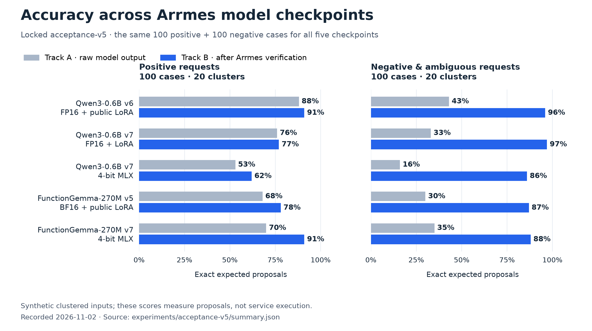
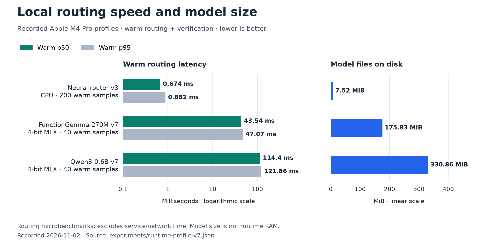

# Arrmes

Local control for your self-hosted media stack.

[](https://github.com/spencernorton/arrmes/actions/workflows/ci.yml)
[](https://github.com/spencernorton/arrmes/tags)
[](LICENSE)

Arrmes turns plain-language requests into API calls to Sonarr, Radarr, Lidarr,
Bazarr, qBittorrent, Tautulli, Seerr and Bitmagnet. Routing runs locally; service
credentials stay in the application.

## What it does

- Check libraries, missing media, queues, watch history and current activity.
- Search Bitmagnet's torrent index.
- Pause or resume a specific qBittorrent transfer.
- Search for missing episodes, movies, albums or subtitles.
- Submit a movie request through Seerr and check your own requests.

For example:

```text
Show Sonarr queue
Show Radarr history
What episodes of Severance are missing in Sonarr?
```

Writes require explicit, single-use confirmation. Ambiguous targets prompt for
clarification. Supported operations vary by service; see the
[capability guide](docs/capabilities.md) for versions and limits.

## Install

Requires Python 3.12+. On macOS or Linux:

```sh
git clone https://github.com/spencernorton/arrmes.git
cd arrmes
python3 -m venv .venv
.venv/bin/python -m pip install -e .
```

Follow the [HTTP setup](docs/portable-runtime.md#authenticated-http-service) to
create private client and service registries, start the server and make a first
request. It starts in model-free mode with read-only permissions.

For learned routing, use the [7.52 MiB neural router](docs/portable-runtime.md#neural-router).
Optional [GGUF](docs/portable-runtime.md#cpu-installation) and
[MLX](docs/portable-runtime.md#routing-backends) backends are also available.
See the runtime guide for [Windows](docs/portable-runtime.md#native-windows)
and [Docker](docs/portable-runtime.md#linux-containers) setup.

## Benchmarks

Recorded neural-router results on the synthetic `acceptance-v5` suite:

| Check | Result |
| --- | --- |
| Exact calls, positive cases (raw and verified) | 1,257 / 1,260 |
| Expected decisions, negative cases (raw and verified) | 1,200 / 1,200 |
| Controlled execution workflows | 52 / 52 |

The execution tests use HTTP fixtures; qualification against actual upstream
applications is partial. [Results and methodology](docs/benchmark-acceptance-v5.md)
include confidence bounds and model comparisons.



Five generative checkpoints on the same 100 positive and 100 negative cases.
[Recorded scores](experiments/acceptance-v5/summary.json) separate raw model
output from verified proposals; these are separate from the full neural-router
results above.



[Recorded Apple M4 Pro profiles](experiments/runtime-profile-v7.json): warm
routing plus verification, excluding service and network time. Disk size is
separate from runtime memory; sample counts and axis scales are labeled.

## Documentation

- [Supported services and configuration](docs/capabilities.md)
- [Runtime setup and measured performance](docs/portable-runtime.md)
- [Subtitle operations](docs/bazarr-subtitles.md), [movie requests](docs/native-requests.md), [media searches](docs/native-arr-writes.md) and [Bitmagnet](docs/native-bitmagnet.md)
- [Contributing](CONTRIBUTING.md), [changelog](CHANGELOG.md) and [security](SECURITY.md)

Questions: [Discussions](https://github.com/spencernorton/arrmes/discussions).
Bugs: [Issues](https://github.com/spencernorton/arrmes/issues).
Security issues: [private reporting](https://github.com/spencernorton/arrmes/security/advisories/new).

## Licence

[MIT](LICENSE) © Spencer Norton. Model weights have separate licences and notices.

Part of [NorviTech](https://norvitech.com) · [Support development](https://buy.stripe.com/8x26oH2U44f65TRe574wM04)
