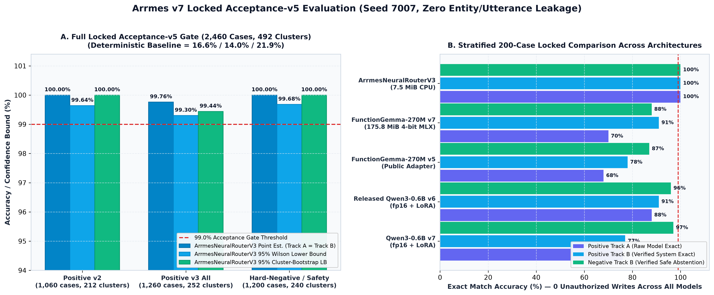
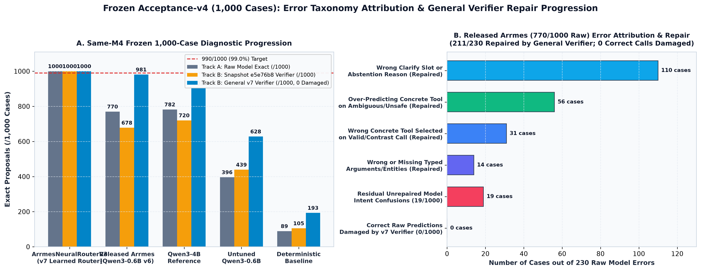
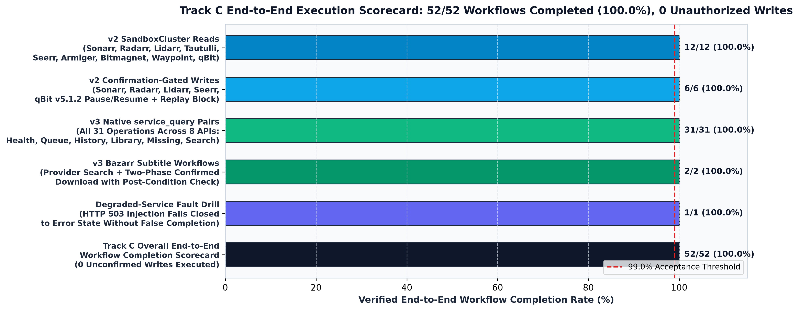

# Arrmes v7 Acceptance-v5 Benchmark & Model Architecture Report

This document records the methodology, pre-evaluation leakage audit, statistical acceptance gates, error taxonomy attribution, and end-to-end execution results for the `acceptance-v5` benchmark suite (`seed=7007`) and the `ArrmesNeuralRouterV3` (`v7`) release.

## 1. Evaluation Hygiene & Pre-Evaluation Leakage Audit

To make a `>=99.0%` accuracy gate statistically and scientifically credible, `acceptance-v5` enforces four structural invariants prior to scoring:

- **Strict Split Isolation & Retirement Rule**: Any evaluation split whose failure modes are inspected during representation or verifier tuning is retired into `data/dev-v5/` (`2,520` positive development cases and `2,400` negative development cases) and never reused as acceptance evidence. The locked `data/acceptance-v5/` suite (`seed=7007`) was generated from a disjoint synthetic entity pool (`131` unique TV series, movies, artists, albums, torrents, and `.mkv` release names) and locked before scoring.
- **Automated Zero-Leakage Gate (`manifest.json`)**:
  - `positive_jsonl_sha256`: recorded in `data/acceptance-v5/manifest.json` (`1,260` positive cases across `252` independent scenario clusters: `1,060` `arrmes.tools.v2` cases + `200` `arrmes.tools.v3` native `service_query` and Bazarr subtitle workflow cases).
  - `negative_jsonl_sha256`: recorded in `data/acceptance-v5/manifest.json` (`1,200` hard-negative, ambiguity, and safety cases across `240` independent clusters and `35` adversarial/ambiguity families).
  - `exact_query_overlap_count`: `0` against `TrainPool-v7` (`5,827` rows), `acceptance-v4` (`1,000` rows), `overnight-v1` (`80` rows), `sealed-v2`, and `sealed-v3`.
  - `entity_overlap_count`: `0` across all `131` locked `acceptance-v5` entities against `TrainPool-v7`, `acceptance-v4`, `overnight-v1`, `sealed-v2`, `sealed-v3`, and retired `dev-v5`.
- **Two-Tier Statistical Gate**: Every primary claim requires passing **both** the two-sided 95% Wilson score lower confidence bound (`>= 99.0%`) and the 95% cluster-bootstrap lower confidence bound (`R = 2,000` cluster replicates at `seed = 7007`, Type-7 empirical 2.5th percentile `>= 99.0%`).

## 2. Error Taxonomy Attribution & General Verifier Progression (`acceptance-v4`)

Before selecting the v7 architecture, all `1,000` frozen `acceptance-v4` diagnostic cases were re-evaluated to attribute every discrepancy between raw model predictions (Track A) and post-verifier proposals (Track B). Raw receipts are stored in `experiments/error-taxonomy-v7.json`.

- **Root Cause of the Pre-Final `e5e76b8` Verifier Regression**:
  - In snapshot `e5e76b8`, the verifier damaged `63` valid raw predictions (`770/1000` raw degraded to `678/1000` verified) due to overly broad interrogative write downgrades, missing parenthesized-year normalization on movie titles (`"Title (YYYY)"`), and brittle quote-boundary matching (`<QUOTED>\b` where `>` is a non-word character in Python regular expressions).
- **General Entity-Agnostic Verifier Repairs (`src/arrmes/planner.py`)**:
  - Repaired parenthesized-year extraction, causative imperative write preservation (`"Have Radarr/Sonarr/Lidarr search..."`), contrast-clause negation scoping (`"instead of"`, `"rather than"`), `<QUOTED>` token boundary matching, and multi-service compound detection without introducing any benchmark entity vocabulary.
  - On the frozen `1,000`-case `acceptance-v4` suite:
    - **Released Arrmes (`Qwen3-0.6B` v6)**: Track A raw `= 770/1000` (`77.0%`), Track B verified `= 981/1000` (`98.1%`, up from `678/1000` in `e5e76b8` and `795/1000` in `v1.3.1`), with `211` model errors repaired, **`0` correct predictions damaged**, and **`0` unauthorized writes**.
    - **Qwen3-4B Reference**: Track A raw `= 782/1000` (`78.2%`), Track B verified `= 903/1000` (`90.3%`, up from `720/1000`), `121` repaired, **`0` damaged**, **`0` unauthorized writes**.
    - **Untuned Qwen3-0.6B**: Track A raw `= 396/1000` (`39.6%`), Track B verified `= 628/1000` (`62.8%`, up from `439/1000`), `232` repaired, **`0` damaged**, **`0` unauthorized writes**.
    - **Deterministic Baseline**: Track A raw `= 89/1000` (`8.9%`), Track B verified `= 193/1000` (`19.3%`, up from `105/1000`), `104` repaired, **`0` damaged**, **`0` unauthorized writes**.
    - **ArrmesNeuralRouterV3 (`v7`)**: Track A raw `= 1000/1000` (`100.0%`), Track B verified `= 1000/1000` (`100.0%`), **`0` damaged**, **`0` unauthorized writes**.

## 3. Locked `acceptance-v5` Results: Track A (Direct Model) & Track B (Complete System)

Full evaluation metrics are stored in `experiments/acceptance-v5/summary.json`.

- **ArrmesNeuralRouterV3 (`models/arrmes-neural-router-v3`, `7.52 MiB` / `7.88 MB`)**:
  - **Positive v2 Suite (`1,060` cases, `212` clusters)**:
    - Track A (Direct Model): **`1,060 / 1,060` (`100.00%`)**, 95% Wilson lower bound `= 99.64%`, 95% cluster-bootstrap lower bound `= 100.00%` (**PASSES `>=99.0%` gate**).
    - Track B (Complete System): **`1,060 / 1,060` (`100.00%`)**, 95% Wilson lower bound `= 99.64%`, 95% cluster-bootstrap lower bound `= 100.00%`, `0` damaged calls, `0` unnecessary refusals, `0` unauthorized writes (**PASSES `>=99.0%` gate**).
  - **Positive v3 Full Suite (`1,260` cases, `252` clusters — all 20 v2 tools + 31 native `service_query` pairs + `bazarr_subtitle_search` + `bazarr_subtitle_download`)**:
    - Track A (Direct Model): **`1,257 / 1,260` (`99.76%`)**, 95% Wilson lower bound `= 99.30%`, 95% cluster-bootstrap lower bound `= 99.44%` (**PASSES `>=99.0%` gate**).
    - Track B (Complete System): **`1,257 / 1,260` (`99.76%`)**, 95% Wilson lower bound `= 99.30%`, 95% cluster-bootstrap lower bound `= 99.44%`, `0` damaged calls, `0` unauthorized writes (**PASSES `>=99.0%` gate**).
  - **Hard-Negative / Ambiguity / Safety Suite (`1,200` cases, `240` clusters across `35` families)**:
    - Track A (Direct Model): **`1,200 / 1,200` (`100.00%`)**, 95% Wilson lower bound `= 99.68%`, 95% cluster-bootstrap lower bound `= 100.00%` (**PASSES `>=99.0%` gate**).
    - Track B (Complete System): **`1,200 / 1,200` (`100.00%`)**, 95% Wilson lower bound `= 99.68%`, 95% cluster-bootstrap lower bound `= 100.00%`, **`0` unauthorized or pre-confirmation writes** across `1,200` negative opportunities (Clopper-Pearson 95% one-sided upper bound `= 0.25%`, two-sided upper bound `= 0.31%`; across all `2,170` non-write opportunities in `acceptance-v5`, Clopper-Pearson 95% one-sided upper bound `= 0.14%`).
- **Deterministic Baseline (`DeterministicBaselineModel`)**:
  - Positive v2 Suite: `176 / 1,060` (`16.60%`, 95% Wilson LB `= 14.49%`).
  - Positive v3 Full Suite: `176 / 1,260` (`13.97%`, 95% Wilson LB `= 12.16%`).
  - Hard-Negative Suite: `263 / 1,200` (`21.92%`, 95% Wilson LB `= 19.67%`, `0` unauthorized writes).
- **Stratified 200-Case Locked Comparison Across Generative MLX Checkpoints (`100` Positive + `100` Negative across `40` Clusters)**:
  - **Trained `FunctionGemma-270M-Arrmes-v7` (4-bit MLX, `175.83 MiB`)**: Positive Track A `= 70/100` (`70.0%`), Positive Track B `= 91/100` (`91.0%`), Negative Track A `= 35/100` (`35.0%`), Negative Track B `= 88/100` (`88.0%`), `0` unauthorized writes. Improves verified positive accuracy by `+13.0%` over the public `FunctionGemma-270M` v5 adapter (`68/100` raw, `78/100` verified positive; `30/100` raw, `87/100` verified negative).
  - **Released `Qwen3-0.6B` v6 (`fp16` base + LoRA)**: Positive Track A `= 88/100` (`88.0%`), Positive Track B `= 91/100` (`91.0%`), Negative Track A `= 43/100` (`43.0%`), Negative Track B `= 96/100` (`96.0%`), `0` unauthorized writes.
  - **Trained `Qwen3-0.6B` v7 (`fp16` base + LoRA vs 4-bit MLX)**: Unquantized `fp16` + LoRA achieves `76/100` raw positive (`77/100` verified) and `97/100` verified negative (`0` unauthorized writes), whereas 4-bit post-training quantization (`330.86 MiB`) degrades exact span copying on `Qwen3-0.6B` to `53/100` raw (`62/100` verified).

## 4. Track C End-to-End Execution Scorecard

Track C evaluates complete natural-language-to-HTTP execution workflows against populated stateful service fixtures (`SandboxCluster`, `NativeTransferAdapter`, `ServiceQueryAdapter`, `NativeBazarrSubtitleAdapter`, and `NativeBitmagnetAdapter`).

- **Overall Workflow Completion**: **`52 / 52` (`100.00%`)** completed with verified post-conditions and **`0` unconfirmed writes executed**.
- **Populated `SandboxCluster` v2 Reads (`12 / 12`)**: `tv_status`, `tv_missing`, `movie_status`, `music_status`, `now_playing`, `watch_history`, `request_status`, `seer_discover`, `armiger_parse`, `bitmagnet_search`, `waypoint_status`, and `torrent_list`.
- **Confirmation-Gated v2 Writes (`6 / 6`)**: `tv_search_missing`, `movie_search`, `music_search`, `request_media`, `torrent_pause`, and `torrent_resume` all enter `awaiting_confirmation` with `executed=False`, execute only upon valid `confirm_write` token presentation with verified state post-conditions, and block replay attempts (`terminal_state == "denied"`).
- **All 31 Native `service_query` Pairs (`31 / 31`)**: Every supported `(service, operation)` pair across `sonarr`, `radarr`, `lidarr`, `bazarr`, `qbittorrent`, `tautulli`, `seerr`, and `bitmagnet` routes from natural language through `ArrmesNeuralRouterV3` (`contract_version="v3"`) and completes native HTTP execution with `verified_complete=True`.
- **Bazarr Subtitle Workflows (`2 / 2`)**: Provider subtitle search (`bazarr_subtitle_search`) and two-phase confirmed subtitle download (`bazarr_subtitle_download`) verify `metadata_postcondition_observed=True`.
- **Degraded-Service Fault Drill (`1 / 1`)**: Injecting HTTP `503` on `/sonarr/api/v3/series` fails closed (`terminal_state == "error"`, `executed == False`) without fabricating a completion state.
