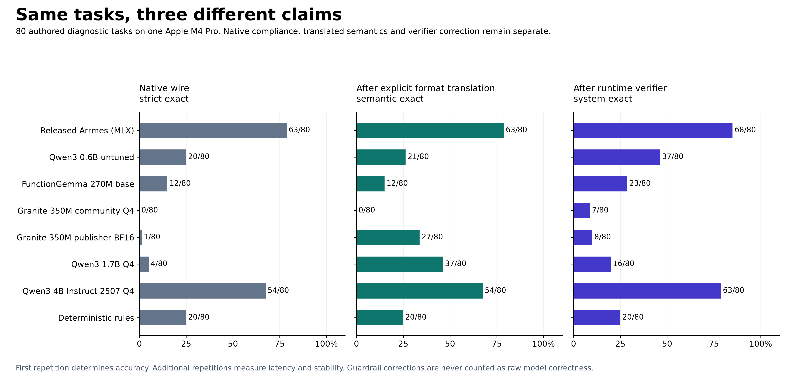
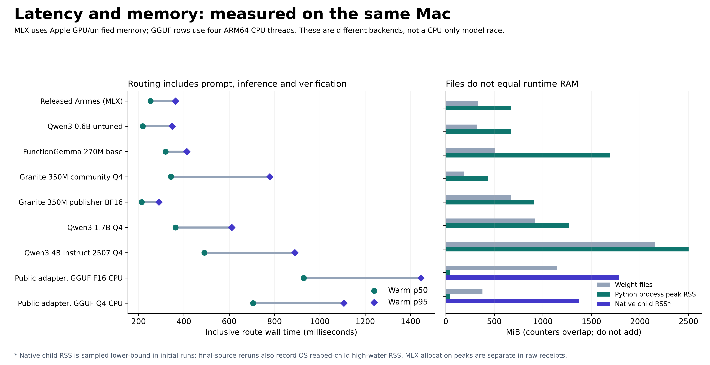

# Arrmes comparative diagnostics

The published specialist is useful on the measured media tasks, but the broad
product and qualification claims need narrower wording. On 80 newly authored
cases, public Arrmes gets **63/80 raw exact** and **68/80 after verification**.
The same untuned Qwen3 0.6B gets 20/80 raw; the stronger Qwen3 4B Instruct 2507
reference gets 54/80 raw. These are results on this diagnostic set, not a general
ranking of model families.

The improved source retains the same weights and scores the same **63/80 raw,
68/80 verified** on this v2 task set. Its strict fixture score is 30/35 versus
28/35 for the original source, but fixture metadata and privacy placeholders
differ between these environments; that difference is not evidence of better
model quality. New native execution and confirmation behavior is demonstrated
by separately identified integration tests below. This work did not retrain the
model or improve its raw prediction accuracy.



## What was measured

The primary comparison chart uses one Apple M4 Pro and identical released v2
tools, policy, tasks and 160-token output limit. Greedy decoding and disabled
thinking are fixed for reproducibility; they are not every publisher's preferred
best-quality recipe. Model identity, quantization, revisions, artifact hashes,
packages, hardware and raw outputs are retained in `experiments/overnight-v1/`.
Separate Linux CPU and NVIDIA results use different hardware and backend settings.

The comparisons cover actual public Arrmes, preserved internal v6, the identical
untuned Qwen base, FunctionGemma 270M base, Granite 350M community Q4 and publisher
BF16, Qwen3 1.7B Q4, Qwen3 4B Instruct 2507 Q4, and the existing deterministic
keyword baseline. The Granite Q4 conversion fails even the publisher's simple
weather-tool smoke while publisher BF16 succeeds; this configuration result must
not be generalized to every Granite deployment.

The deterministic baseline's legacy token counts, tokens-per-second and allocator
memory fields are synthetic placeholders, not measured inference or RAM. Its
outer routing-function wall time is measured separately. Current runtime code
reports unavailable token/allocator telemetry as null; the old receipts retain
their original values and predictions.

Three scores remain separate:

- **A: raw model behavior.** Strict native tool format, tool selection, arguments
  and entities are scored before repair. A separate format-translation score
  accepts only a complete JSON call, optionally in the exact native wrapper, and
  valid serialized JSON arguments. It never extracts JSON from prose or repairs
  arguments. Qwen3 1.7B gets 4/80 strict but 37/80 translated; hiding that
  distinction would misrepresent its semantic quality.
- **B: runtime behavior.** Verifier corrections, scope checks, refusals and write
  confirmation are assessed separately. A correction never counts as a correct
  raw model prediction.
- **C: controlled execution.** Real HTTP adapters run against reset synthetic
  SQLite fixtures. Correct expected writes receive an explicit simulated operator
  confirmation. Erroneous writes are never automatically authorized. Of 35
  oracle-executable operations, released Arrmes matches **28/35** frozen business
  observations. The legacy exact-call/completed-terminal metric is 30/35; two
  stricter failures retain a public-source Tautulli fixture-IP difference
  (original source fixture address differed from the frozen oracle; public placeholders coincide), rather than silently omitting the field.

The 80 cases include all 20 released tools, ambiguity, references, negated writes,
unsafe and compound requests, unavailable services, denied scopes and adversarial
entity text. Accuracy uses the predefined first pass; repeated outputs provide
latency and stability samples, not additional independent cases.

## Qualification and provenance findings

The exact public adapter at revision
`8a9bcf224e6f9fd6bf238267093c70360ee837cb`, with public release source
`a536483a75ada2d4d26f7bc93ee0790695f6e697`, reproduces **296/314 raw exact
(94.27%)** on the historical sealed-v3 corpus. It gets **310/314 verified
(98.73%)**, rather than the published 313/314. Four unexpected raw write proposals
include one that survives the released verifier: “Pause the active torrent
download” is treated as a torrent named `active`. No historical-replay write was
executed.

The subsequent transfer-descriptor grounding fix produces **311/314 verified**
and zero surviving unexpected write proposals when replaying those saved raw
outputs. Raw accuracy remains 296/314. This is a post-result safety repair, not
new neural accuracy or independent qualification. The new 80-case replay remains
63 raw / 68 verified.

The later split audit finds 37 normalized wording intersections between
programmatic training candidates and historical sealed-v3, covering 261/314
sealed rows. Old family IDs are mainly entity IDs; zero family overlap therefore
does not establish template disjointness. The regenerated 4,389-row training file now verifies against original SHA-256
`59f4e8085cc096434a5b7395ce476fed06990c109ca5e232cfe774d285a4de73`.
It confirms the same 37 template intersections covering 261/314 sealed rows.
There is zero full query-plus-context overlap; 34 repeated query strings have
different selected-media contexts. A read-only reconstruction of the actual v6
selection prefix returns 502 v2 plus 147 v1 records (649 including repeats), zero
full-input overlap, and 229 sealed rows sharing selected templates. The first 60
dev rows are validation only. No directories, training files or model artifacts
are changed by that reconstruction; it does not establish the public adapter's lineage. The new set has zero exact-query overlap with those
candidates, new fictional entities, and one known Armiger template overlap
(ON1-023). Its frozen labels remain unchanged; it is diagnostic, not a wholly
template-disjoint acceptance set.

The public adapter also differs materially from the preserved internal v6
checkpoint. Their hashes and behavior are recorded separately. They must not be
substituted as equivalent provenance.

## Portability and performance



On the same Mac, four-thread ARM64 CPU inference with exact-public GGUF F16 gets
64/80 raw and 68/80 verified. Q4 gets 64/80 raw in the predefined first pass and
63/80 in each later pass; all three passes get 72/80 verified. Three raw outputs
vary across repetitions. This supports useful aggregate behavior, not identical
predictions after conversion or quantization.

On an actual Ryzen 9 7950X3D Linux x86_64 host, two CPU threads and nice 15, the
Mac-exported Q4 gets 66/80 raw and Linux-exported Q4 gets 65/80 raw. Both get 72/80
verified and complete 32/35 executable fixture operations. The fused tensors
match exactly, while platform quantizers produce different Q4 bytes and a
one-point raw difference. Linux-exported Q4 warm routing p50/p95 is 1.133/1.705 s.

On that Linux host with an RTX 4070 Ti SUPER and pinned llama.cpp CUDA image,
240 samples give **61.88/87.68 ms routing p50/p95**, 64/80 first-pass raw exact,
72/80 verified and 32/35 executable operations. The **63.67/89.10 ms fixture
benchmark wall** includes grading instrumentation, so it is not pure product
request latency. CUDA uses context 4096, two CPU threads, batch 256 and microbatch
128; its settings differ from CPU. Monitored memory observes about 727 MB native
process high-water RSS and a **sampled peak of 1082 MiB VRAM**, a lower bound on
true allocation peak. The tested optional CUDA image is 6,999,497,751 bytes.

The released model's timing field excludes prompt rendering, tokenization,
prefix-cache preparation/copy, decoding and verification. Its roughly 230–245 ms
claim is warm generation-core timing. In the new 80-case run, generation p50 is
249.7 ms and inclusive routing p50/p95 is 252.7/363.0 ms. Historical public replay
generation timing is 264.2/372.8 ms warm p50/p95. Fixture benchmark wall metrics
include two expected-answer grading calls between inference and execution; retain
that instrumentation label on existing results.

A separate **actual authenticated HTTP** test measures client POST through bearer
authentication, the MLX main-thread queue, runtime, executor and fixture HTTP:
**250.0/342.7 ms p50/p95**, 40 requests over eight read tasks after two warmups.
This uses the server's 64-token cap and is a different task mix. TLS, remote
network delay, concurrent load and human confirmation delay are not measured.

Fresh-process launch to first route takes 1.932, 1.936 and 1.942 s for MLX, versus
19.566, 19.405 and 19.494 s for Mac CPU Q4. Downloads are excluded and OS file
caches are not flushed. Linux CUDA model-load-plus-first-route is 1.769 s; that
is a different boundary from process launch.

Weight files are 345,563,976 bytes for MLX base plus public adapter and about
396.7 MB for Q4 GGUF. Linux CPU Q4 needs about 1.23 GB native peak RSS plus 44 MB
Python peak RSS. Mac Q4 needs about 1.43 GB native RSS. MLX reports 708.8 MB Python
process RSS and 2.22 GB peak unified-memory allocation; those overlapping counters
must not be added or described as dedicated VRAM.

## Working integration and remaining limits

The six existing trained native read names now pass actual public-model inference
through executor, native HTTP and independent fixture business-field checks:
TV status/missing, movie status, music status, current Plex activity and watch
history. The runtime completes 6/6, each with one actual `neural_v2` inference and
no legacy gateway configured. Duplicate-series ambiguity clarifies and a
controlled Radarr 503 returns an error: 8/8 expected outcomes, zero non-GET
requests. Queries and source were frozen before inference; source/model/adapter/
config/harness fingerprints match before and after. This is an integration smoke,
not a new quality benchmark. The measured source is public base
`613e6bd49d06b566ae02f16fc0fee829c640a006` plus the separately preserved uncommitted
source snapshot, not that commit alone.

Actual public-model inference through runtime, native qBittorrent adapters,
confirmation and state verification passes **8/8 scenarios** across qBittorrent
4.6.7 and 5.1.2. Four request phrasings select pause/resume; no mutation occurs
before confirmation, exactly one form POST uses the confirmed hash, state is
verified, and replay is denied. This is an integration smoke, not language
qualification.

Released Arrmes observes zero unsafe or unauthorized executions across 63 unique
non-write opportunities. A 4.64% one-sided binomial upper bound is only nominal
under an i.i.d. assumption; these authored, correlated diagnostics are not a
representative production sample, so it is not a production-risk bound.

Historical 26/26 workflows use scripted dependent proposals and assess the
executor rather than neural workflow selection. The original six new two-turn
workflow receipts have incomplete artifact/harness identification and remain
unchanged as legacy diagnostics. Fully identified reruns for five models are
stored separately: public Arrmes matches 4/6 expected dialogue outcomes, untuned
base 1/6, Qwen3 1.7B 1/6, Qwen3 4B 2/6 and deterministic baseline 1/6. One dialogue
is clarification-only, so public Arrmes matches 3/5 service dialogues plus that
control; the other baselines mostly match only that control. These are separately
presented user turns with a trusted conditional driver, not autonomous neural
plan generation. These are diagnostics, not fresh acceptance.
Their model/adapter/config hashes, revisions, backend/settings, source and harness
fingerprints are captured before and after inference; the expected-call business
oracle is frozen before model loading. Success requires an exact executed call,
correct terminal and matching business observations, not only `completed`. Context is derived only from actual
verified observations, never expected calls.

Native Windows CPU/CUDA generation remains hardware-untested. Other accelerators,
concurrent load, real service-version diversity, long conversations and production
workflows remain unqualified. Expanded explicit-service reads are a separate
representation; new adapter operations do not prove the released model learned
new tools. Further write workflows and a genuinely scenario/entity/template-disjoint
acceptance cohort remain necessary before comprehensive public claims.

[pyarr](https://github.com/totaldebug/pyarr) is a relevant typed API-client approach.
Its 30 structured Sonarr/Radarr read operations get 20 exact checks and zero
mutations: TV/movie lookup succeeds, while the per-series missing helper exposes
a fixture/API filter mismatch. It is supplied structured operations, so its
roughly 1.56 ms median is not NLP routing latency or model accuracy.
[MediaStack MCP](https://github.com/clive-stokes/mediastack-mcp) documents broad
observation and two-step-confirmed actions with an external model/controller. Its
documented coverage is a useful product reference; it was not executed here and
receives no numerical ranking.

## Reproduce

Run from the repository root in an isolated Python environment. Follow
[portable installation](portable-runtime.md) for native runtime/model
setup and licensing. Pin model revisions and verify file hashes from the receipts.
Qwen/Granite are Apache 2.0; FunctionGemma uses the Gemma terms. CPU inference does
not require MLX or CUDA.

For an Apple Silicon comparison with locally pinned base and adapter:

```sh
python -m pip install -e '.[test,mlx]'
python scripts/benchmark_comparison.py \
  --backend mlx --family hermes \
  --model ./models/pinned-base --adapter ./adapters/pinned-public \
  --label reproduced-mlx --repetitions 3 \
  --output ./work/reproduced-mlx.json
python scripts/score_benchmark_outputs.py ./work/reproduced-mlx.json
```

For the hash-checked public source export and a local native CPU runtime on `PATH`:

```sh
python scripts/restore_benchmark_source.py --output ./work/measured-source
python scripts/benchmark_comparison.py \
  --source-root ./work/measured-source \
  --backend llama-server --device cpu --threads 2 --family hermes \
  --model ./models/pinned-public-q4.gguf \
  --label reproduced-cpu --repetitions 3 \
  --output ./work/reproduced-cpu.json
```

For the original release, select an immutable checkout of public commit
`a536483a75ada2d4d26f7bc93ee0790695f6e697` with `--source-root`; its original
fixture SQL requires SQLite 3.46+, while later source includes compatibility fixes.
The owner-private bundle preserves the exact uncommitted measurement source.
Any public privacy transformation must record original and exported hashes
separately; do not claim transformed sources have the original private hashes.

The public receipts preserve raw model predictions, labels, counts, timings and
memory measurements. Local paths and host identifiers are omitted; a private
loopback fixture address becomes the public loopback placeholder. Source snapshots
retain original and exported SHA-256 values and restore the exported bytes only.
Inline native fixture source is a separate Python attachment with a hash. See
[the export ledger](receipt-export.json) for every original/exported file digest
and transformation. Reproduction on this public source can differ from the
original private fixture environment; the owner evidence bundle preserves the
exact original source and receipt bytes. A public file digest must not be used
as proof of the original measurement source.

Audit splits, replay saved outputs through a changed verifier, and regenerate the
report without training or changing labels:

```sh
python scripts/audit_benchmark_splits.py
python scripts/replay_benchmark_verifier.py \
  --receipt ./experiments/overnight-v1/released-arrmes.json \
  --output ./work/current-verifier-diagnostic.json
python -m pip install matplotlib numpy
python scripts/report_benchmark_comparison.py
```

To rerun workflows on the separately identified public workflow source export:

```sh
python scripts/restore_benchmark_source.py \
  --snapshot ./experiments/overnight-v1/workflow-source-v2.jsonl \
  --output ./work/workflow-source
python scripts/benchmark_workflows.py \
  --source-root ./work/workflow-source --backend mlx \
  --model ./models/pinned-base --adapter ./adapters/pinned-public \
  --model-revision BASE_REPOSITORY_AT_IMMUTABLE_REVISION \
  --adapter-revision ADAPTER_REPOSITORY_AT_IMMUTABLE_REVISION \
  --oracle ./work/reproduced-workflow-oracle.json \
  --label reproduced-workflows --output ./work/reproduced-workflows.json
python scripts/rescore_benchmark_observations.py \
  ./experiments/overnight-v1/released-arrmes.json
```

The report generator reads the versioned named receipts. New reproduction runs
remain separate. `compact_benchmark_receipts.py` retains decoded JSON equality,
records original/compact byte hashes, and can create a deterministic evidence ZIP.
No model weights, real credentials or production library data are included.

Primary model references:
[Qwen3 0.6B](https://huggingface.co/Qwen/Qwen3-0.6B),
[Qwen3 1.7B](https://huggingface.co/Qwen/Qwen3-1.7B),
[Qwen3 4B Instruct 2507](https://huggingface.co/Qwen/Qwen3-4B-Instruct-2507),
[Granite 350M](https://huggingface.co/ibm-granite/granite-4.0-350m),
[FunctionGemma](https://huggingface.co/google/functiongemma-270m-it).
