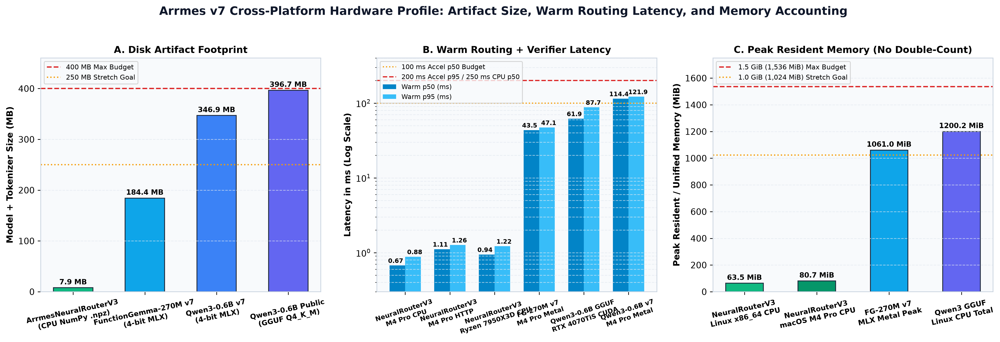

# Installation and runtime guide

## Routing backends

| Backend | Runtime | Model |
| --- | --- | --- |
| `neural-router` | CPU, no inference dependencies | [Arrmes neural router](https://huggingface.co/NorviTech/arrmes-neural-router-v3), 7.52 MiB |
| `native-only` | No model; explicit service commands | None |
| `mlx` | Apple Silicon; install `.[mlx]` | [Qwen3-0.6B](https://huggingface.co/NorviTech/arrmes-qwen3-0.6b) or [FunctionGemma-270M](https://huggingface.co/NorviTech/arrmes-functiongemma-270m) with its matching MLX base and adapter |
| `llama-server` | Native llama.cpp on CPU or a supported accelerator | Fused GGUF; the published conversion is experimental |

All backends use the same caller permissions and write-confirmation checks.
See [measured performance](#arrmes-v7-runtime--footprint-profile-2026-11-02) and
[platform qualification](#evidence-and-limits) for tested configurations.

## Install the package

From the Arrmes checkout, using Python 3.12+ on macOS or Linux:

```sh
python3 -m venv .venv
. .venv/bin/activate
python -m pip install -e .
```

On Windows, use the [PowerShell instructions](#native-windows).
Next, set up the [authenticated HTTP service](#authenticated-http-service).
That example starts with model-free reads; add a model backend when needed.

## Neural router

Download the published router from a pinned revision; no training is needed.
From the checkout, on macOS or Linux:

```sh
curl --fail --location --create-dirs \
  --output models/arrmes-neural-router-v3/router_weights.npz \
  https://huggingface.co/NorviTech/arrmes-neural-router-v3/resolve/9d44632bb344d7517ed1f922114c1df49c0bdec2/router_weights.npz
curl --fail --location \
  --output models/arrmes-neural-router-v3/router_config.json \
  https://huggingface.co/NorviTech/arrmes-neural-router-v3/resolve/9d44632bb344d7517ed1f922114c1df49c0bdec2/router_config.json
printf '%s  %s\n' e640ead79ceee2929ccf63ec6f9d953d9cd8d85e76e011483bf336abe6235113 \
  models/arrmes-neural-router-v3/router_weights.npz | shasum -a 256 --check
```

With the HTTP setup's client and service variables exported, stop any running
Arrmes server and run from the checkout:

```sh
export ARRMES_BACKEND=neural-router
export ARRMES_MODEL_PATH="$PWD/models/arrmes-neural-router-v3"
python -m arrmes.server
```

The router works with the core package alone. NumPy is optional. Model files
and service credentials are not included in Git.

## Authenticated HTTP service

For a first model-free read installation, create the client registry and a local
curl header file in a fresh configuration directory. This generates a token
without printing it; both new files are private and existing files are refused:

```sh
python3 - <<'PY'
import hashlib, json, os, secrets
token = secrets.token_urlsafe(32)
registry = {"clients": [{"subject": "local:operator",
    "token_sha256": hashlib.sha256(token.encode()).hexdigest(),
    "scopes": ["media:read", "torrents:read", "activity:read", "releases:read"]}]}
for path, body in [("clients.json", json.dumps(registry)),
                   ("client-header.txt", "Authorization: Bearer " + token + "\n")]:
    descriptor = os.open(path, os.O_WRONLY | os.O_CREAT | os.O_EXCL, 0o600)
    with os.fdopen(descriptor, "w") as output:
        output.write(body)
print("Created clients.json and client-header.txt")
PY
```

Create `services.json` using the native registry example in
[capabilities.md](capabilities.md#native-api-configuration), then start:

```sh
export ARRMES_CLIENTS_FILE="$PWD/clients.json"
export ARRMES_SERVICES_FILE="$PWD/services.json"
export ARRMES_BACKEND=native-only
python -m arrmes.server
```

From a second terminal in that configuration directory:

```sh
curl --header @client-header.txt --header 'Content-Type: application/json' \
  --data '{"query":"Show Sonarr queue"}' http://127.0.0.1:8095/v1/execute
```

The example grants read scopes only. Model-free mode accepts explicit service
commands and asks for clarification outside that grammar. Both registries load
at startup; restart after edits.

To enable the documented Bazarr/Seerr writes in model-free mode, set
`ARRMES_NATIVE_CONFIRMED_WRITES=1` and `ARRMES_WRITE_MODE=confirm`, and deliberately
grant `media:manage` for subtitle operations or `requests:create` for requests.
Each step requires single-use confirmation. See [subtitles](bazarr-subtitles.md)
and [Seerr requests](native-requests.md) for required arguments and identity
mapping. Transfer controls require a model backend and their management scope.

`ARRMES_WRITE_MODE=disabled` prevents writes for every backend. The HTTP service
rejects direct write mode.

For legacy gateway actions, configure `ARRMES_GATEWAY_URL` and `GES_KEY_FILE`
instead of native service credentials. `ARRMES_REQUEST_OWNER_SUBJECT` identifies
the gateway credential's request owner; other callers cannot submit gateway
media requests.

To attach an already managed native runtime, set `ARRMES_INFERENCE_URL` to its
HTTP(S) origin instead of launching a model child. It must implement native
`/apply-template`, `/completion` and `/health`. This is not a generic
OpenAI-compatible inference-provider client. Device/memory settings belong to
that external process; response metadata reports `device=external`.
Keep it on a private network: Arrmes caller authentication protects Arrmes,
not a separately exposed llama-server port.

## CPU installation

Set `ARRMES_BACKEND=llama-server`, `ARRMES_MODEL_PATH` to the fused GGUF,
`ARRMES_MODEL_FAMILY=hermes`, `ARRMES_LLAMA_SERVER` to its executable,
`ARRMES_DEVICE=cpu`, and optionally `ARRMES_THREADS`/`ARRMES_CONTEXT_SIZE`.
Do not pass an MLX adapter path alongside GGUF: it must already contain the
chosen adapter, and the factory rejects an unfused extra adapter.

Export a fused GGUF using the [conversion recipe](#exact-model-portability-recipe),
or use a model you have already exported and verified. The experimental
396,704,352-byte Q4_K_M artifact used in the historical tests is currently
unavailable from GitHub Releases. Its recorded SHA-256 is
`c7d6f1eef1eb4cd0f93769dadca7e270f3c3d470cfb542240733859c7d02f255`.

Model-file size is not a RAM requirement. The [measurements](#evidence-and-limits)
depend on backend, context and hardware; Windows memory remains unmeasured.

Use Python 3.12 or later. From the Arrmes checkout:

```sh
python3 -m venv .venv
.venv/bin/python -m pip install .
```

Install the native runtime from the pinned
[llama.cpp b11429 release](https://github.com/ggml-org/llama.cpp/releases/tag/b11429),
or build it with CMake and a C++ compiler. Run these commands on the intended
Linux or macOS CPU host:

```sh
git clone --depth 1 --branch b11429 https://github.com/ggml-org/llama.cpp.git
cmake -S llama.cpp -B llama.cpp/build -DGGML_CUDA=OFF -DGGML_METAL=OFF -DLLAMA_OPENSSL=OFF
cmake --build llama.cpp/build --target llama-server llama-quantize -j 2
```

Point `--llama-server` to the resulting executable if it is not on `PATH`.
Supply a fused, hash-checked GGUF. The Hugging Face Arrmes repository
provides the MLX LoRA used by the conversion recipe, which produces
revision-specific artifacts.

```sh
.venv/bin/python -m arrmes route --backend llama-server --family hermes \
  --contract-version v2 --model /absolute/path/model-q4_k_m.gguf \
  --llama-server /absolute/path/llama.cpp/build/bin/llama-server \
  --device cpu --threads 4 'Which episodes of Sintel are missing?'
```

This command produces a dry-run plan. It does not connect to media services.
`--execute-sandbox` exercises only controlled local fixtures. A managed native
child binds to loopback, uses one slot and shuts down with the application.
CPU is explicit (`--n-gpu-layers 0`); it does not silently require a GPU build.

## Native Windows

Install 64-bit Python 3.12+ and extract
`llama-b11429-bin-win-cpu-x64.zip` from the same official release into a local
directory. Keep its DLLs beside `llama-server.exe`. In PowerShell:

```powershell
py -3.12 -m venv .venv
.\.venv\Scripts\python.exe -m pip install .
.\.venv\Scripts\python.exe -m arrmes route --backend llama-server --family hermes --contract-version v2 --model C:\Arrmes\model-q4_k_m.gguf --llama-server C:\Arrmes\llama\llama-server.exe --device cpu --threads 4 "Which episodes of Sintel are missing?"
```

After downloading the separate GGUF, verify it with
`(Get-FileHash C:\Arrmes\model-q4_k_m.gguf -Algorithm SHA256).Hash` against the
full digest above. Keep its license and notice files. This CPU path has actual
hosted CI generation evidence for v1.2.0, with the scope recorded above. For NVIDIA,
use the official `llama-b11429-bin-win-cuda-12.4-x64.zip` and its matching
`cudart-llama-bin-win-cuda-12.4-x64.zip`, then select `--device cuda`.
The installed driver must support that runtime. Arrmes never installs or alters
host drivers. A missing `CUDA` device produces a clear startup error.

## NVIDIA and other accelerators

For a native Linux CUDA build, follow the upstream
[CUDA build instructions](https://github.com/ggml-org/llama.cpp/blob/b11429/docs/build.md#cuda)
and set `-DGGML_CUDA=ON` in a separate build directory. Select `--device cuda`.
The backend enumerates compiled devices and selects the matching native device;
it refuses an unavailable accelerator rather than silently labelling CPU work
as GPU work. `--device metal`, `vulkan`, and `sycl` use the corresponding builds.

CPU and accelerator dependencies stay separate. A CPU installation does not
download CUDA packages. Linux NVIDIA measurements are separate from unified
Apple memory: the tested Q4 workload's maximum observed native-process VRAM
was 1,082 MiB, sampled through NVML at roughly one-second intervals, with about
727 MB native host RSS. Transient VRAM peaks between samples remain unmeasured.
No VRAM measurement is claimed for Windows
or other accelerators.

## Linux containers

`Dockerfile` packages the Python application without model weights or secrets.
`compose.yaml` pairs it with the pinned upstream CPU server image. Supply
absolute host paths in environment variables:

```text
ARRMES_GGUF_FILE=/absolute/path/model-q4_k_m.gguf
ARRMES_CLIENTS_FILE=/absolute/path/clients.json
ARRMES_SERVICES_FILE=/absolute/path/services.json
ARRMES_UID=1000
ARRMES_GID=1000
```

The default Compose example enables native service reads without a custom
gateway. Set `ARRMES_UID`/`ARRMES_GID` to the owner of the private registry files
(the values from `id -u`/`id -g` on that host), so the non-root application can
read files protected with mode 0600. Defaults are 10001:10001. The inference
port is private to the Compose network. Only Arrmes port 8095 binds
to host loopback. Both images run without root, writable root filesystems or
added capabilities; model and secret mounts are read-only. No startup command
downloads a model or contacts a media service.

```sh
docker compose -f compose.yaml config --quiet
docker compose -f compose.yaml up --build
```

On a Linux NVIDIA host with an existing working NVIDIA Container Toolkit:

```sh
docker compose -f compose.yaml -f compose.cuda.yaml up --build
```

The CUDA override pulls a separate pinned CUDA image and requests one GPU.
The native CUDA inference image was hardware-tested; the complete CUDA Compose
application topology was configuration-validated. These files are installation examples;
they do not deploy to the production estate or replace its Git-backed rollout.

Packaging has a material GPU cost: Docker reports approximately 7.00 GB for
the pinned CUDA image, versus 297.7 MB for the CPU inference image and 46 MB
for the Arrmes application image. These are image bytes, not RAM or VRAM, and
shared Docker layers can overlap. CPU installation never pulls the CUDA image.

The exact benchmark launcher is retained at
`experiments/portable-v1/launchers/llama-server`. It runs only a temporary native
CUDA inference container, mounts the selected GGUF read-only and forwards the
native server flags. On the tested Linux host, the benchmark used that directory
first on `PATH`, then ran `scripts/benchmark_comparison.py --backend llama-server
--device cuda --threads 2 --repetitions 3` with the CPU-exported GGUF and frozen
80-case dataset/oracle. The result records the launcher hash, image digest,
generation settings and source hashes. The external lease/safety monitor
recorded per-process VRAM and container host-PID RSS; Docker-client child RSS is
retained separately and is not labelled native-model RAM.

For the optional legacy gateway, also set `ARRMES_GATEWAY_URL` and
`ARRMES_GATEWAY_KEY_FILE`, then include `-f compose.gateway.yaml` after the
base file (and after `compose.cuda.yaml` when using both). An empty
`{"services": {}}` registry is permitted for gateway-only use. Preserve the
gateway-owner restriction on identity-sensitive media requests.

## Arrmes v7 Runtime & Footprint Profile (2026-11-02)



Full receipts and 4-phase memory accounting are stored in `experiments/runtime-profile-v7.json`:

- **ArrmesNeuralRouterV3 (`ARRMES_BACKEND=neural-router`, CPU NumPy)**:
  - **Artifact Size**: `7,884,621` bytes (`7.88 MB` / `7.52 MiB`), meeting both the `<= 400 MB` budget and `<= 250 MB` stretch goal.
  - **Apple M4 Pro (`macOS ARM64` CPU)**: Cold load `16.71 ms`, first route `4.97 ms`, warm model-only `p50 = 0.484 ms` / `p95 = 0.684 ms`, warm routing + verifier `p50 = 0.674 ms` / `p95 = 0.882 ms`, and full authenticated HTTP loopback (`POST /v1/route`) `p50 = 1.113 ms` / `p95 = 1.264 ms`. Four-phase RSS: `64.33 MiB` before load, `80.47 MiB` after load, `80.56 MiB` post-warmup, and `80.70 MiB` peak evaluation RSS (meeting both `<= 1.5 GiB` and `<= 1.0 GiB` stretch budgets).
  - **AMD Ryzen 9 7950X3D (`Linux x86_64` CPU)**: Cold load `26.18 ms`, first route `6.40 ms`, warm model-only `p50 = 0.726 ms` / `p95 = 0.979 ms`, warm routing + verifier `p50 = 0.944 ms` / `p95 = 1.219 ms`. Four-phase RSS: `47.52 MiB` before load and `63.50 MiB` peak evaluation RSS.
- **FunctionGemma-270M-Arrmes-v7 (`4-bit MLX`, Apple M4 Pro Metal)**:
  - **Artifact Size**: `184,369,263` bytes (`184.37 MB` / `175.83 MiB`), meeting both `<= 400 MB` and `<= 250 MB` stretch budgets.
  - **Latency & Memory**: Warm model generation `p50 = 41.53 ms` / `p95 = 45.24 ms` (`548.3 tok/s`), warm routing + verifier `p50 = 43.54 ms` / `p95 = 47.07 ms` (within the `<= 100 ms` p50 / `<= 200 ms` p95 acceleration budget), MLX Metal unified peak `1,060.96 MiB`.
- **Qwen3-0.6B-Arrmes-v7 (`4-bit MLX`, Apple M4 Pro Metal)**:
  - **Artifact Size**: `346,928,831` bytes (`346.93 MB` / `330.86 MiB`), meeting the `<= 400 MB` budget.
  - **Latency & Memory**: Warm model generation `p50 = 112.04 ms` / `p95 = 119.42 ms` (`256.7 tok/s`), warm routing + verifier `p50 = 114.40 ms` / `p95 = 121.86 ms`, MLX Metal unified peak `1,593.34 MiB`.

## Evidence and limits

- Apple M4 Pro, macOS ARM64: released MLX inference and native llama.cpp CPU
  inference exercised on actual hardware. The benchmark report records sample
  counts and backend differences. Metal GGUF qualification is separate.
- AMD Ryzen 9 7950X3D, Linux x86_64: native CPU build at llama.cpp
  `d81235049384534c167caea52b85a694f6103d14` and actual GGUF-to-fixture execution
  exercised on hardware. Build used two low-priority workers; inference used
  two CPU threads and no GPU. Package-main bootstrap with a local GGUF file,
  caller authentication, real routing and managed-child shutdown also pass.
  Paired 80-case runs compare CPU-exported and Mac-exported quantized artifacts
  on this same host. This shared host is not an uncontended benchmark machine.
- Linux ARM64 Docker on the Mac's virtual machine: five packaging, authenticated
  real-GGUF routing and native-fixture execution checks pass using the actual
  package entrypoint. The isolated network and containers were removed. This
  is a virtual ARM64 test, not an x86_64 hardware test.
- Linux NVIDIA: actual RTX 4070 Ti SUPER, driver 595.99.02, tested through the
  pinned official CUDA container and Arrmes' native backend/executor. Eighty
  unique tasks and 240 timing samples ran under an acquired GPU lease with a
  2 GiB workload budget, at least 8 GiB reserved free and no Plex transcoding.
  All test containers were removed and the lease released. This does not prove
  a native host CUDA build or Windows CUDA behavior.
- Windows x86_64 CPU: actual native GGUF inference passed in a hosted Windows
  Server 2025 AMD64 CI runner. Four documented model calls, one controlled
  activity fixture and all eight operational checks passed with the exact
  public C7 artifact and official b11429 CPU runtime. This tested installed
  v1.2.0 product source, separately from later core Python CI and native
  compilation. It is not owned Windows hardware, broad model accuracy or RAM
  qualification. [Receipt and offline verification](windows-cpu-qualification.md).
- Windows NVIDIA: backend/device selection and installation paths are
  implemented, but actual CUDA generation has not been tested.
- Other ARM64 CPUs, Vulkan and SYCL: implemented native-runtime selection where
  available; not hardware-tested. Unsupported builds fail with a device error.

On Linux the 396,704,480-byte public-adapter Q4_K_M model consumed about 1.19 GB
of native-process peak RSS at a 4,096-token context and one slot. Application
RSS is additional. Model bytes are not runtime RAM. Cold full-prompt routing
took roughly 15 seconds at two threads; later smoke requests took about one
second. These four smoke cases are far too few for p50/p95 accuracy claims.
Exact tool+argument+terminal checks passed two of four: a torrent filter broadened
to `all`, and a Radarr movie query selected `music_status` before clarification.
Those failures remain in the raw receipt.

The separate 80-case comparison provides a broader, still bounded result:
the public MLX adapter gets 63/80 raw and 68/80 verified exact calls, native
F16 gets 64/80 and 68/80, and native Q4_K_M gets 64/80 and 72/80 on the same
Mac hardware. Per-case greedy outputs differ. This supports a useful portable
path over this task range; it does not erase the smoke failures or qualify
every service/platform. The comparison report retains all raw predictions.

On Linux NVIDIA, the same CPU-exported Q4 artifact gets 64/80 raw and 72/80
verified exact calls, with 32/35 executable fixture workflows. Across 240 warm
samples, routing p50/p95 is 61.9/87.7 ms. The retained 63.7/89.1 ms fixture-wall
measurement includes two grading passes as well as execution; it is a
benchmark-instrumented duration, not production request latency.
Model load plus the first route is 1.769 seconds. This uses two CPU threads,
one CUDA device, context 4,096, batch 256 and microbatch 128. It is a separate
backend experiment; the CPU run uses its recorded native defaults. Raw
predictions differ, and zero unsafe executions is a verifier/system result.

Receipts are retained in `experiments/portable-v1/`; fuller model comparisons
belong to the separate benchmark report. The old ~230–245 ms figure measures
warm MLX generation within `LocalModel.infer`; it excludes template rendering,
tokenization, cache preparation/copy, verification, execution and HTTP overhead.
It is not complete request latency.

Service API qualification is separate from inference support. A disposable
Linux ARM64 Sonarr 4.0.20.3014 instance on the Mac Docker VM passes selected
empty-library reads through native-only Arrmes and a GET-only Docker transport
bridge. This does not qualify other services, seeded entities, search, missing
media, writes or direct cross-container TCP. To reproduce on a local ARM64
Docker Desktop context, pull the single pinned image documented in
`scripts/smoke_sonarr_upstream.py`, then run `python scripts/smoke_sonarr_upstream.py
--output work/sonarr-upstream-smoke.json`. The harness requires sampled resource
headroom, uses one CPU/768 MiB, isolates networking and removes its test resources.

### Model-free measurements

On the measured Mac, the model-free package started in a fresh Python 3.12
environment with only jsonschema and its small transitive dependencies. Six
bootstrap/authentication/read/abstention checks passed while imports of MLX,
PyTorch, Transformers, NumPy and llama-cpp-python were explicitly blocked.
The reproducible check is `python scripts/smoke_native_only.py --output
work/native-only-smoke.json`.

A separate frozen explicit-read HTTP workload completed 140/140 expected
business outcomes over 14 tasks with no upstream writes. Client request p50/p95
was 1.35/1.70 ms and the isolated application process peak RSS was 47,955,968
bytes. These synthetic loopback requests use a restricted deterministic grammar;
their task mix differs from the neural comparison. They do not establish a
model speedup, production latency or broad language understanding. Six access
and abstention controls also passed. Inputs, package versions, source hashes
and every request are in `experiments/overnight-v1/native-only-http.json`.

## Exact adapter export and provenance

The original MLX base revision is
`mlx-community/Qwen3-0.6B-4bit@73e3e38d981303bc594367cd910ea6eb48349da8`.
The actual public Arrmes adapter is
`NorviTech/arrmes-qwen3-0.6b@8a9bcf224e6f9fd6bf238267093c70360ee837cb`,
SHA-256 `a9a7ab8705d68e16f0e9597d96e2ddf58b6f3dfffcecf683e2b36c8b11f23fab`.
Its 196 LoRA tensors are float32. The internal final v6 file has a different
hash and differs in every tensor, with maximum absolute difference 0.00627327;
directory names and earlier rounded scrub claims do not establish equivalence.

### CPU-only export, tested on Linux x86_64

`scripts/export_mlx_cpu_gguf.py` does not import MLX or initialize a GPU.
It accepts only the checked MLX Qwen3 affine 4-bit/group64 layout, validates
every paired LoRA tensor/rank/scale, unpacks in bounded row chunks and applies
the same source-precision merge arithmetic. Its 310 fused tensors match the
official MLX export exactly: zero differing elements, maximum absolute error
0.0. Three optional codec/merge tests also pass in the CPU export environment.

Use a separate environment on Linux or Windows. The tested Linux versions are
pinned in `requirements-export-cpu.txt`; torch uses the official CPU index:

```sh
python3 -m venv work/export-venv
work/export-venv/bin/python -m pip install torch==2.15.0 --index-url https://download.pytorch.org/whl/cpu
work/export-venv/bin/python -m pip install -r requirements-export-cpu.txt
```

On Windows use that environment's `Scripts/python.exe` path. Download the
immutable base/adapter with `huggingface_hub.snapshot_download` (installed by
the converter dependencies), retaining their licenses and metadata:

```python
from huggingface_hub import snapshot_download
from urllib.request import urlretrieve

snapshot_download("mlx-community/Qwen3-0.6B-4bit",
                  revision="73e3e38d981303bc594367cd910ea6eb48349da8",
                  local_dir="work/export/base",
                  allow_patterns=["*.json", "*.safetensors", "*.jinja", "README.md", "LICENSE*"])
snapshot_download("NorviTech/arrmes-qwen3-0.6b",
                  revision="8a9bcf224e6f9fd6bf238267093c70360ee837cb",
                  local_dir="work/export/adapter",
                  allow_patterns=["adapter_config.json", "adapters.safetensors", "README.md", "LICENSE*"])
urlretrieve("https://huggingface.co/Qwen/Qwen3-0.6B/resolve/c1899de289a04d12100db370d81485cdf75e47ca/LICENSE",
            "work/export/QWEN-LICENSE.txt")
```

Run this from the checkout with the pinned native runtime source/build from
the installation section. Windows substitutes its native executable paths:

```sh
work/export-venv/bin/python scripts/export_mlx_cpu_gguf.py \
  --base work/export/base --adapter work/export/adapter \
  --base-reference mlx-community/Qwen3-0.6B-4bit@73e3e38d981303bc594367cd910ea6eb48349da8 \
  --adapter-reference NorviTech/arrmes-qwen3-0.6b@8a9bcf224e6f9fd6bf238267093c70360ee837cb \
  --license-file work/export/QWEN-LICENSE.txt \
  --llama-source llama.cpp \
  --llama-revision d81235049384534c167caea52b85a694f6103d14 \
  --quantize-binary llama.cpp/build/bin/llama-quantize \
  --threads 2 --output work/export/linux-cpu-v1
```

The CPU exporter was run on Linux x86_64 with `torch 2.15.0+cpu` and no MLX.
CPU and Mac quantizers at the same source revision produce different packed
bytes in 197/310 tensors despite exactly identical fused inputs. Treat them
as separately hashed artifacts and compare behavior. The paired Linux run in
the benchmark report checks that distinction: Mac-exported Q4 gets 66/80 raw
and 72/80 verified exact calls; CPU-exported Q4 gets 65/80 and 72/80. Both
complete 32/35 executable fixture workflows with zero unsafe or unauthorized
write executions. These are 80 unique cases with one repetition per artifact,
at two CPU threads. CPU-exported routing p50/p95 is 1.133/1.705 seconds;
benchmark-instrumented fixture wall is 1.135/1.708 seconds and includes
expected-answer grading. Its model-load plus first route is 14.049
seconds, native process RSS about 1.23 GB and Python parent RSS 44 MB. These
Linux measurements must stay separate from Mac comparisons. They establish
similar aggregate behavior on this set, not identical predictions or universal
accuracy. Never infer quantized parity from the fused tensor check alone.

### Optional Apple Silicon reference export

The Apple Silicon conversion tool uses official MLX fusion with
`--dequantize`, avoiding an intermediate re-quantization of the LoRA update.
Use a separate Python environment for the pinned llama.cpp converter's torch
requirements. This environment is not part of Arrmes CPU inference.

```sh
python scripts/export_gguf.py --base /absolute/path/pinned-mlx-base \
  --adapter /absolute/path/pinned-public-adapter \
  --base-reference mlx-community/Qwen3-0.6B-4bit@73e3e38d981303bc594367cd910ea6eb48349da8 \
  --adapter-reference NorviTech/arrmes-qwen3-0.6b@8a9bcf224e6f9fd6bf238267093c70360ee837cb \
  --license-file /absolute/path/upstream-APACHE-2.0.txt \
  --llama-source /absolute/path/llama.cpp \
  --llama-revision d81235049384534c167caea52b85a694f6103d14 \
  --conversion-python /absolute/path/converter-venv/bin/python \
  --quantize-binary /absolute/path/llama-quantize \
  --output /absolute/path/new-export-revision
```

The destination must be new. The receipt records immutable inputs, SHA-256
digests, library revision, license copies, every modified matrix and output
bytes. The actual public export verifies 98/98 fused LoRA target weights exactly
and all 310 GGUF tensors against their intended F16/F32 casts. Those are tensor
checks, not a claim of equivalent logits after fusion or quantization.
The native chat prompt was byte-identical to the released MLX rendering in the
documented smoke case. The benchmark must still compare raw calls and safe
workflow outcomes over the same tasks.

Both the base and public adapter declare Apache-2.0. Retain the license,
upstream attribution and applicable NOTICE text with redistributed modified
weights, and identify the merge/conversion/quantization changes.
[Qwen license](https://huggingface.co/Qwen/Qwen3-0.6B/blob/c1899de289a04d12100db370d81485cdf75e47ca/LICENSE),
[public adapter metadata](https://huggingface.co/NorviTech/arrmes-qwen3-0.6b/tree/8a9bcf224e6f9fd6bf238267093c70360ee837cb),
[llama.cpp MIT license](https://github.com/ggml-org/llama.cpp/blob/b11429/LICENSE).
FunctionGemma has separate Gemma terms and is not included in this GGUF export.

No new GGUF is published as a qualified replacement for v1.1.0. Preserve the
released adapter and benchmark as the baseline until conversion quality and
platform-specific behavior meet independently frozen acceptance criteria.

## Runtime selection tradeoff

The native llama.cpp path provides one GGUF representation and embedded chat
template across CPU and accelerator builds. Keeping it behind a small HTTP
boundary also avoids requiring a Python binary wheel for every Python/OS/GPU
combination. It costs a native executable, child-process lifecycle management
and local HTTP overhead. The backend preserves unconstrained native output;
neither a forced tool grammar nor a format translator improves its raw score.
[llama.cpp server](https://github.com/ggml-org/llama.cpp/tree/b11429/tools/server)
and [build documentation](https://github.com/ggml-org/llama.cpp/blob/b11429/docs/build.md).

`llama-cpp-python` is a viable in-process alternative, with CPU wheels and
accelerator-specific build options. We selected the native server to keep the
Python installation independent of those wheel/build combinations; no speed
comparison against that binding was run.
[Primary installation documentation](https://github.com/abetlen/llama-cpp-python#installation).

ONNX Runtime GenAI documents CPU, CUDA, DirectML and other acceleration options
across multiple architectures. It remains a plausible future Windows path. An
ONNX graph and another qualified quantization/export path would add maintenance
work to this increment; it was investigated, not implemented or benchmarked.
[Primary project documentation](https://github.com/microsoft/onnxruntime-genai).
Transformers also supports multiple quantization integrations. It is used in
the optional export environment, while Arrmes CPU inference remains independent
of it. No portable Transformers inference comparison is claimed.
[Primary quantization documentation](https://huggingface.co/docs/transformers/v5.22.1/main_classes/quantization).
